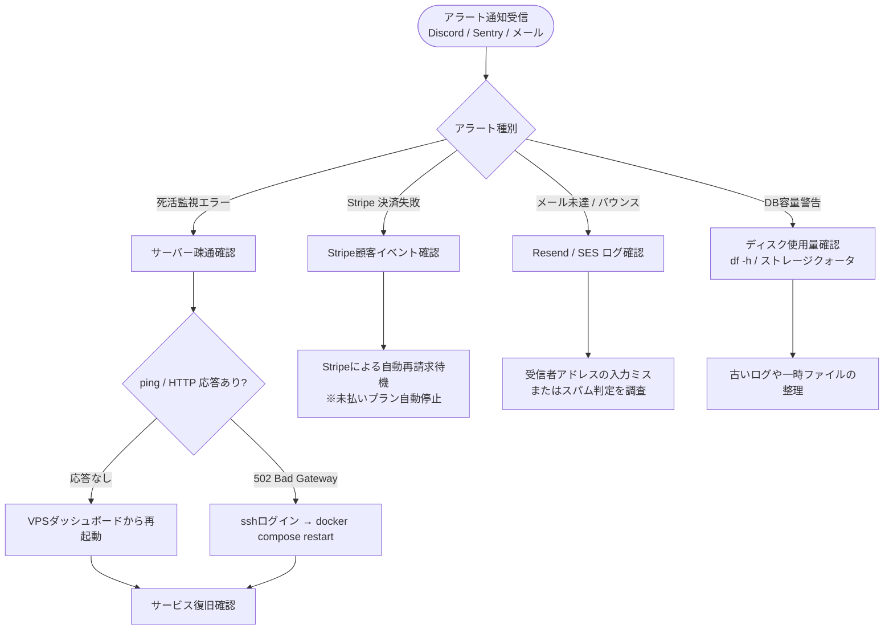

# デンケイ 運用者・デプロイヤー向けマニュアル (v1.2)

このマニュアルは、デンケイ（Denkei）を自社サーバーやクラウドにデプロイ・運用する管理者・運用者向けです。Docker によるセルフホスティング、環境変数設定、監視・バックアップ、アップグレード手順、課金運用を解説します。

エンドユーザー向けの操作手順は `USER_MANUAL.md`、よくある質問は `Q&A.md` を参照してください。

---

## 目次

1. [デンケイの運用アーキテクチャ](#1-デンケイの運用アーキテクチャ)
2. [デプロイ構成の選択](#2-デプロイ構成の選択)
3. [スタンドアロン構成で起動（SMB低コスト）](#3-スタンドアロン構成で起動smb低コスト)
4. [本番構成で起動](#4-本番構成で起動)
5. [環境変数の完全リファレンス](#5-環境変数の完全リファレンス)
6. [プラン・課金の運用](#6-プラン課金の運用)
7. [公式ランディングページの運用](#7-公式ランディングページの運用)
8. [組織請求書・適格請求書（インボイス）の運用](#8-組織請求書適格請求書インボイスの運用)
9. [電子署名証明書の設定](#9-電子署名証明書の設定)
10. [データベース管理・マイグレーション](#10-データベース管理マイグレーション)
11. [バックアップとリストア](#11-バックアップとリストア)
12. [アップグレード手順](#12-アップグレード手順)
13. [モニタリング・ヘルスチェック](#13-モニタリングヘルスチェック)
14. [トラブルシューティング](#14-トラブルシューティング)
15. [セキュリティ運用チェックリスト](#15-セキュリティ運用チェックリスト)
16. [個人開発・手離れ運用ワークフロー](#16-個人開発手離れ運用ワークフロー)
17. [年間運用予定表（年間スケジュール）](#17-年間運用予定表年間スケジュール)

---

## 1. デンケイの運用アーキテクチャ

デンケイは Docker コンテナベースで動作するモノレポアプリケーションです。主要な構成要素は以下の通りです。

### 構成要素

| 要素 | 役割 | 推奨構成 |
|------|------|---------|
| アプリケーション | React Router v7 + Hono サーバー | Docker コンテナ (ポート3000) |
| データベース | PostgreSQL 15 | Docker コンテナ または 管理済みDB |
| ストレージ | アップロードファイル保存 | データベース内包 または S3互換 |
| メール送信 | 署名依頼・完了通知メール | SMTP / Resend / MailChannels / SES |
| ジョブキュー | 非同期処理（メール送信、文書シール等） | PostgreSQL 内蔵 (local) |
| 電子署名 | PDFへのPAdESデジタル署名 | P12ファイル (local) または Google Cloud HSM |
| 決済 | Stripe サブスクリプション課金 (JPY) | Stripe ダッシュボード連携 |

### 推奨最小構成（SMB Standalone）

外部 Redis・有料TSA・従量課金SMSを排除し、PostgreSQL 1台＋アプリ 1台で運用します。`docker/compose.standalone.yml` の Lean Profile では、ジョブキュー `local`・TSA 無効・本人確認メールOTP・ストレージ `database` が既定です。

- 契約あたり原価: 約 0.2〜0.5 円
- 月額目安: 2,980 円（スタンダードプラン・月 100 契約、`packages/lib/constants/plans.ts`）

#### サービス提供者側コスト内訳

| コスト種別 | 項目 | 目安 |
|-----------|------|------|
| 変動費（1契約） | メール送信（依頼・OTP・リマインダー・完了の5〜8通） | 約 0.1〜0.3 円 |
| 変動費（1契約） | 文書PDF＋監査ログの保存 | 0.1 円未満 |
| 変動費（1契約） | 外部TSA（タイムスタンプ）・SMS認証 | 0 円（不使用） |
| 固定費（月額） | アプリ＋PostgreSQL コンテナのホスティング | 数百円〜数千円 |
| 固定費（月額） | S3互換ストレージ（database トランスポート時は不要） | 数百円 |
| 固定費（月額） | Stripe決済手数料（課金有効時） | 売上の約 3.6% |

タイムスタンプは外部TSAを使用せず、WORMストレージ＋監査ログ（SHA-256ハッシュチェーン）で電帳法の保存要件に対応します（`docker/README.md` 参照）。

---

## 2. デプロイ構成の選択

| 構成 | 用途 | ファイル | 特徴 |
|------|------|---------|------|
| スタンドアロン | 開発・中小企業本番 | `docker/compose.standalone.yml` | PostgreSQL + アプリ、外部依存なし |
| 本番 | 一般的な本番環境 | `docker/production/compose.yml` | 公式イメージ使用、外部DB想定 |
| 一クリック | クラウドプラットフォーム | デプロイボタン | Railway / Render / Koyeb / Elestio |

開発・検証用にはスタンドアロン構成を、本番運用には本番構成を推奨します。

---

## 3. スタンドアロン構成で起動（SMB低コスト）

### 前提条件

- Docker および Docker Compose がインストール済み
- 8 GB 以上のメモリ（推奨）
- ディスク空き容量 20 GB 以上

### 手順

#### 1. リポジトリをクローン

```bash
git clone https://github.com/annahoikuen-debug/denkei.git
cd denkei/denkei
git checkout v1.1
```

#### 2. 環境変数ファイルを作成

```bash
cp .env.example .env
```

`.env` を編集し、以下を必ず設定してください：

```bash
# 認証用シークレット（32文字以上のランダム文字列）
NEXTAUTH_SECRET="your-super-secret-key-32chars"

# 暗号化鍵（32文字以上）
NEXT_PRIVATE_ENCRYPTION_KEY="your-encryption-key-32chars"

# 二次暗号化鍵（32文字以上）
NEXT_PRIVATE_ENCRYPTION_SECONDARY_KEY="your-secondary-key-32chars"

# アプリ公開URL（本番ドメイン）
NEXT_PUBLIC_WEBAPP_URL="https://denkei.example.com"

# SMTP設定（メール送信用）
NEXT_PRIVATE_SMTP_HOST="smtp.example.com"
NEXT_PRIVATE_SMTP_PORT="587"
NEXT_PRIVATE_SMTP_USERNAME="your-smtp-user"
NEXT_PRIVATE_SMTP_PASSWORD="your-smtp-password"
NEXT_PRIVATE_SMTP_FROM_NAME="デンケイ 電子契約"
NEXT_PRIVATE_SMTP_FROM_ADDRESS="noreply@example.com"
```

課金機能を有効にする場合は、さらに以下を設定してください（§6 参照）：

```bash
NEXT_PUBLIC_FEATURE_BILLING_ENABLED="true"
NEXT_PRIVATE_STRIPE_API_KEY="sk_live_..."
NEXT_PRIVATE_STRIPE_WEBHOOK_SECRET="whsec_..."
NEXT_PRIVATE_STRIPE_PRICE_ID_STANDARD="price_..."
NEXT_PRIVATE_STRIPE_PRICE_ID_BUSINESS="price_..."
```

#### 3. コンテナを起動

```bash
docker compose -f docker/compose.standalone.yml up -d
```

#### 4. 起動確認

```bash
docker compose -f docker/compose.standalone.yml logs -f app
```

正常に起動すると、`http://localhost:3000`（または `NEXT_PUBLIC_WEBAPP_URL`）でアプリケーションにアクセスできます。初回起動時に Prisma マイグレーションが自動適用されます。

### アクセスポイント

| サービス | URL | 説明 |
|---------|-----|------|
| メインアプリ | http://localhost:3000 | デンケイ本体 |
| 公式ランディングページ | http://localhost:3000/lp | 六つ道具・コスト診断シミュレーター |
| データベース | コンテナ内:5432 | PostgreSQL（ホストへポート公開なし。`docker compose -f docker/compose.standalone.yml exec db psql -U denkei denkei` で接続） |

---

## 4. 本番構成で起動

公式 Docker イメージ `documenso/documenso:latest` を使用する構成です。

### 手順

#### 1. 環境変数ファイルを作成

```bash
cp .env.example .env
```

本番構成では以下が必須です（`production/compose.yml` で `:?err` チェックあり）：

- `NEXTAUTH_SECRET`
- `NEXT_PRIVATE_ENCRYPTION_KEY`
- `NEXT_PRIVATE_ENCRYPTION_SECONDARY_KEY`
- `NEXT_PUBLIC_WEBAPP_URL`
- `NEXT_PRIVATE_DATABASE_URL`
- `NEXT_PRIVATE_SMTP_TRANSPORT`
- `NEXT_PRIVATE_SMTP_FROM_NAME`
- `NEXT_PRIVATE_SMTP_FROM_ADDRESS`

課金機能を有効にする場合は、さらに以下が必須です：

- `NEXT_PUBLIC_FEATURE_BILLING_ENABLED="true"`
- `NEXT_PRIVATE_STRIPE_API_KEY`
- `NEXT_PRIVATE_STRIPE_WEBHOOK_SECRET`
- `NEXT_PRIVATE_STRIPE_PRICE_ID_STANDARD`
- `NEXT_PRIVATE_STRIPE_PRICE_ID_BUSINESS`

#### 2. 署名証明書を配置（P12を使用する場合）

```bash
mkdir -p /opt/documenso
cp your-signing-certificate.p12 /opt/documenso/cert.p12
chmod 600 /opt/documenso/cert.p12
```

#### 3. コンテナを起動

```bash
docker compose -f docker/production/compose.yml up -d
```

---

## 5. 環境変数の完全リファレンス

### 必須設定

| 変数 | 説明 | デフォルト | 必須 |
|------|------|-----------|------|
| `NEXTAUTH_SECRET` | 認証セッション用シークレット | - | Yes |
| `NEXT_PRIVATE_ENCRYPTION_KEY` | データ暗号化プライマリ鍵 | - | Yes |
| `NEXT_PRIVATE_ENCRYPTION_SECONDARY_KEY` | データ暗号化セカンダリ鍵 | - | Yes |
| `NEXT_PUBLIC_WEBAPP_URL` | アプリ公開URL | - | Yes |
| `NEXT_PRIVATE_DATABASE_URL` | データベース接続URL | - | Yes |
| `NEXT_PRIVATE_SMTP_FROM_NAME` | 送信者名 | - | Yes |
| `NEXT_PRIVATE_SMTP_FROM_ADDRESS` | 送信メールアドレス | - | Yes |

### データベース

| 変数 | 説明 | デフォルト |
|------|------|-----------|
| `NEXT_PRIVATE_DIRECT_DATABASE_URL` | マイグレーション用直接DB URL | `NEXT_PRIVATE_DATABASE_URL` |
| `POSTGRES_USER` | DBユーザー名 | `denkei` |
| `POSTGRES_PASSWORD` | DBパスワード | `denkei_secure_password_123` |
| `POSTGRES_DB` | DB名 | `denkei` |

### サーバー

| 変数 | 説明 | デフォルト |
|------|------|-----------|
| `PORT` | サーバー待受ポート | `3000` |
| `NEXT_PUBLIC_BASE_PATH` | サブパス配信（例: /ESign） | 空 |

### ストレージ

| 変数 | 説明 | デフォルト |
|------|------|-----------|
| `NEXT_PUBLIC_UPLOAD_TRANSPORT` | ストレージプロバイダ | `database` |
| `NEXT_PRIVATE_UPLOAD_ENDPOINT` | S3エンドポイント | - |
| `NEXT_PRIVATE_UPLOAD_REGION` | S3リージョン | `us-east-1` |
| `NEXT_PRIVATE_UPLOAD_BUCKET` | S3バケット名 | - |
| `NEXT_PUBLIC_DOCUMENT_SIZE_UPLOAD_LIMIT` | アップロード制限MB | `10`（スタンドアロン構成プリセット） |

### 電子署名

| 変数 | 説明 | デフォルト |
|------|------|-----------|
| `NEXT_PRIVATE_SIGNING_TRANSPORT` | 署名トランスポート | `local` |
| `NEXT_PRIVATE_SIGNING_LOCAL_FILE_PATH` | P12ファイルパス | `/opt/documenso/cert.p12` |
| `NEXT_PRIVATE_SIGNING_PASSPHRASE` | P12パスフレーズ | - |
| `NEXT_PRIVATE_SIGNING_ENABLE_TSA` | 外部TSA利用 | `false` |
| `NEXT_PRIVATE_SIGNING_TIMESTAMP_AUTHORITY` | TSA URL | - |
| `NEXT_PRIVATE_SIGNING_REASON` | 署名理由 | `Signed by Documenso` |
| `NEXT_PUBLIC_SIGNING_CONTACT_INFO` | 連絡先情報 | WebApp URL |
| `NEXT_PRIVATE_SIGNING_ALLOW_LOCAL_IN_PRODUCTION` | 本番でのP12許可フラグ | 未設定 |

### メール送信

| 変数 | 説明 | デフォルト |
|------|------|-----------|
| `NEXT_PRIVATE_SMTP_TRANSPORT` | メールプロバイダ | `smtp-auth` |
| `NEXT_PRIVATE_SMTP_HOST` | SMTPホスト | `127.0.0.1:2500` |
| `NEXT_PRIVATE_SMTP_PORT` | SMTPポート | `587` |
| `NEXT_PRIVATE_SMTP_USERNAME` | SMTPユーザー | -（未設定時は認証なし） |
| `NEXT_PRIVATE_SMTP_PASSWORD` | SMTPパスワード | - |
| `NEXT_PRIVATE_RESEND_API_KEY` | Resend APIキー | - |
| `NEXT_PRIVATE_MAILCHANNELS_API_KEY` | MailChannels APIキー | - |

### 認証・本人確認

| 変数 | 説明 | デフォルト |
|------|------|-----------|
| `NEXT_PRIVATE_IDENTITY_PROVIDER` | 本人確認プロバイダ | `otp` |
| `NEXT_PUBLIC_DISABLE_SIGNUP` | 新規登録無効化 | - |
| `NEXT_PUBLIC_DISABLE_SIGNIN` | ログイン無効化 | - |
| `NEXT_PRIVATE_ALLOWED_SIGNUP_DOMAINS` | 許可ドメイン | - |
| `NEXT_PRIVATE_GOOGLE_CLIENT_ID` | Google OAuthクライアントID | - |
| `NEXT_PRIVATE_GOOGLE_CLIENT_SECRET` | Google OAuthクライアントシークレット | - |

### ジョブキュー

| 変数 | 説明 | デフォルト |
|------|------|-----------|
| `NEXT_PRIVATE_JOBS_PROVIDER` | ジョブプロバイダ | `local` |
| `NEXT_PRIVATE_REDIS_URL` | Redis URL (BullMQ用) | -（BullMQ使用時のみ必須） |

### プラン定義（`packages/lib/constants/plans.ts`）

| プラン | 月額(税抜) | 月次送信上限 | 主な機能 |
|-------|-----------|------------|---------|
| 無料(FREE) | 0円 | 3件 | 基本署名フロー |
| 中小応援スタンダード(STANDARD) | 2,980円 | 100件 | Firebaseメール認証・テンプレート共有 |
| ビジネス(BUSINESS) | 4,980円 | 無制限 | ＋承認フロー・CSV一括送信 |

- タイムスタンプ(RFC3161)は全プランで外部TSAを使用しません。電帳法対応はWORMストレージ＋監査ログ（SHA-256ハッシュチェーン）で実現します。
- 取引先の本人確認はメールOTP(LOW)とFirebase Authenticationメール認証(MEDIUM)のみで、SMS認証は提供しません。
- 課金を有効化する場合は `NEXT_PUBLIC_FEATURE_BILLING_ENABLED=true` に加え、Stripe の設定が必要です。

### 請求・課金（Stripe）

| 変数 | 説明 | デフォルト |
|------|------|-----------|
| `NEXT_PUBLIC_FEATURE_BILLING_ENABLED` | 課金機能有効化 | - |
| `NEXT_PRIVATE_STRIPE_API_KEY` | Stripe APIキー | - |
| `NEXT_PRIVATE_STRIPE_WEBHOOK_SECRET` | Stripe Webhookシークレット | - |
| `NEXT_PRIVATE_STRIPE_PRICE_ID_STANDARD` | STANDARDプラン（月額2,980円）のStripe Price ID | - |
| `NEXT_PRIVATE_STRIPE_PRICE_ID_STANDARD_ANNUAL` | STANDARDプラン（年額29,760円・一括実質2ヶ月無料）のStripe Price ID | - |
| `NEXT_PRIVATE_STRIPE_PRICE_ID_BUSINESS` | BUSINESSプラン（月額4,980円）のStripe Price ID | - |
| `NEXT_PRIVATE_STRIPE_PRICE_ID_BUSINESS_ANNUAL` | BUSINESSプラン（年額49,800円・一括実質2ヶ月無料）のStripe Price ID | - |

Stripe ダッシュボードで以下を設定してください：

1. 製品とプラン価格を作成（STANDARD月額: 2,980円/月、STANDARD年額: 29,760円/年、BUSINESS月額: 4,980円/月、BUSINESS年額: 49,800円/年、JPY）
2. Price ID を `.env` の対応変数に設定
3. Webhook エンドポイントを `https://<ホスト>/api/webhooks/stripe` に設定し、イベント `customer.subscription.updated`, `invoice.paid` などを購読

### テレメトリー

| 変数 | 説明 | デフォルト |
|------|------|-----------|
| `DOCUMENSO_DISABLE_TELEMETRY` | テレメトリー無効化 | - |
| `NEXT_PUBLIC_POSTHOG_KEY` | PostHogキー | - |

---

## 6. プラン・課金の運用

### プラン判定ロジック

チームのプランは `packages/lib/server-only/team/get-team-plan.ts` で判定されます。優先順位は以下の通りです：

1. **Stripe サブスクリプション** - `organisation.subscription.planId` から STANDARD / BUSINESS を判定
2. **組織クレーム（文書クオータ）** - `organisation.organisationClaim.documentQuota` が 100 以上なら STANDARD、null なら BUSINESS
3. **デフォルト** - FREE（月3件）

### 月次送信カウンタ

当月の送信件数は `organisationMonthlyStat` テーブルでカウントされ、Asia/Tokyo 基準の月単位（`YYYY-MM`）でリセットされます。カウンタは `packages/lib/server-only/rate-limit/check-monthly-quota.ts` で管理されます。

### 送信上限チェックの流れ

1. 文書送信リクエストが `createEnvelope` に到達
2. `assertCanSendDocumentForTeam` でチームのプランと当月送信数をチェック
3. 上限超過時は `AppError`（ja: 「当月の送信上限（N通）に達しました。プランをアップグレードしてください。」）でブロック
4. 承認フロー（APPROVER 役割）を使用する場合は、`assertFeatureEnabledForTeam` で BUSINESS プランかチェック

### Stripe Webhook の設定

Stripe ダッシュボードで Webhook エンドポイントを登録し、以下のイベントを購読してください：

- `customer.subscription.created` - サブスクリプション作成
- `customer.subscription.updated` - プラン変更（即時反映）
- `customer.subscription.deleted` - サブスクリプション解約（FREE にダウングレード）
- `invoice.paid` - 請求支払完了（領収書発行トリガー）

Webhook 受信後、`packages/ee/server-only/stripe/` でプラン即時昇格と領収書PDF生成を行います。

### 負荷テスト結果（v1.1 Stage E3）

`scripts/load-test-burst.ts` で 100件のドキュメント生成・送信を並行実行した結果：

| 項目 | 結果 | 基準 |
|------|------|------|
| 総作成件数 | 100件 | - |
| 成功数 | 100件 | - |
| 失敗数 | 0件 | - |
| エラー率 | 0.00% | < 0.1% |
| 総所要時間 | 1.28秒 | - |
| p50 レスポンスタイム | 109ms | < 1秒 |
| p95 レスポンスタイム | 294ms | < 1秒 |
| p99 レスポンスタイム | 295ms | - |

---

## 7. 公式ランディングページの運用

デンケイには中小企業向けの公式ランディングページ（`/lp`）が用意されています。運用上のポイントは以下の通りです。

### ランディングページの構成

| セクション | 内容 | 実装ファイル |
|-----------|------|-------------|
| ヒーロー | キャッチコピー、3大要約、CTAボタン | `apps/remix/app/components/general/landing-page.tsx` |
| 六つ道具 | 電子認印、事務処理規程キット、WORM監査ログ、メールOTP、インボイス適格請求書、月額定額 | 同上 |
| 電子認印10秒体験 | 苗字入力・印影色選択・電子印影プレビュー | 同上 |
| コスト診断シミュレーター | 月間契約書件数による年間コスト削減額・削減時間試算 | 同上 |
| 料金プラン | FREE/STANDARD/BUSINESS の3プラン比較・コスト比較表 | 同上 |

### ランディングページのアクセス

- 開発環境: `http://localhost:3000/lp`
- 本番環境: `https://<ホスト>/lp`

### 運用上の注意

- ランディングページは認証不要で公開アクセス可能です。
- 電子認印のプレビュー生成は `packages/lib/universal/seal-image.ts` の `generateElectronicSealDataUrl()` を使用します（クライアントサイド canvas 動作）。
- コスト診断シミュレーターの試算根拠は、印紙代平均400円＋製本印刷200円＋定形郵送110円、1通あたり約12分の事務処理時間短縮に基づきます。

---

## 8. 組織請求書・適格請求書（インボイス）の運用

デンケイは Stripe 連携により、利用料金に対する適格請求書（インボイス）を発行・管理できます。

### 請求書テーブル（`organisation-billing-invoices-table.tsx`）

組織の請求書一覧を表示し、適格請求書をダウンロードできます。

| 項目 | 説明 |
|------|------|
| 請求書一覧 | 月ごとの請求ステータス、金額、発行日を表示 |
| 適格請求書ボタン | 該当請求書のインボイス対応帳票を表示 |
| 印刷 / PDF保存 | ブラウザの印刷機能で PDF として保存 |

### 適格請求書の記載事項

| 項目 | 内容 |
|------|------|
| 発行者 | 株式会社デンケイ |
| 登録番号 | T1010001999999（適格請求書発行事業者登録番号） |
| 住所 | 東京都千代田区霞が関1-1-1 |
| 消費税率 | 10%（標準税率） |
| 品目 | デンケイ スタンダード月額利用料 (100件/月) 等 |
| 請求金額 | 税抜金額・消費税額・税込金額 |

適格請求書は消費税法第57条の4に定める要件を満たし、仕入税額控除の適用要件を完全に満たします。

### Stripe Webhook と請求書発行フロー

1. Stripe でサブスクリプションが作成・更新される
2. Webhook イベント `customer.subscription.updated` / `invoice.paid` を受信
3. `packages/ee/server-only/stripe/` でプラン即時昇格と領収書PDF生成を行う
4. ユーザーは請求書管理画面から適格請求書をダウンロード可能

### 運用上のチェックリスト

- [ ] Stripe ダッシュボードで Webhook エンドポイントを登録済み
- [ ] Webhook シークレットを `.env` に設定済み
- [ ] Price ID（STANDARD / BUSINESS）を `.env` に設定済み
- [ ] 請求書テーブルが正しく表示されること（E2E で確認）
- [ ] 適格請求書 PDF のダウンロードが正常に動作すること

---

## 9. 電子署名証明書の設定

デンケイはPDFにPAdES (ETSI.CAdES.detached) 形式で電子署名を行います。

### 証明書の種類

| トランスポート | 説明 | 用途 |
|--------------|------|------|
| `local` | P12ファイルによる署名 | 開発・セルフホスティングSMB |
| `gcloud-hsm` | Google Cloud KMSによる署名 | 本番・電子署名法厳格対応 |
| `csc` | CSC (Cloud Signature Consortium) 連携 | AES/QES トラストサービスプロバイダ |

### P12証明書の作成（OpenSSL）

```bash
# 秘密鍵と自己署名証明書を生成
openssl req -x509 -newkey rsa:2048 -keyout key.pem -out cert.pem \
    -days 3650 -nodes -subj "/C=JP/ST=Tokyo/L=Tokyo/O=Denkei/CN=denkei.example.com"

# P12形式に変換
openssl pkcs12 -export -out cert.p12 -inkey key.pem -in cert.pem \
    -name "Denkei Signing Certificate"

# パスフレーズ設定（対話形式で入力）
```

### 設定方法

```bash
# .env または Docker 環境変数
NEXT_PRIVATE_SIGNING_TRANSPORT=local
NEXT_PRIVATE_SIGNING_LOCAL_FILE_PATH=/opt/documenso/cert.p12
NEXT_PRIVATE_SIGNING_PASSPHRASE=your-p12-passphrase
```

Docker ボリュームでマウント：

```yaml
volumes:
  - /opt/documenso/cert.p12:/opt/documenso/cert.p12:ro
```

### 本番環境での注意

- 電子署名法第3条により、本番環境では `gcloud-hsm`（Google Cloud KMS）の使用が推奨されます。
- `local`（P12）を本番で使用する場合は `NEXT_PRIVATE_SIGNING_ALLOW_LOCAL_IN_PRODUCTION=true` の明示的なオプトインが必要です。

### 証明書状態確認

起動後、以下で証明書状態を確認できます：

```
http://<ホスト>:3000/api/certificate-status
```

---

## 10. データベース管理・マイグレーション

### マイグレーションの適用

Docker コンテナ起動時に自動適用されます。手動で適用する場合：

```bash
# スタンドアロン構成
docker compose -f docker/compose.standalone.yml exec app \
    npx prisma migrate deploy --schema ../../packages/prisma/schema.prisma

# またはホストから直接
npm run prisma:migrate-deploy
```

### 主なマイグレーション

| マイグレーション | 内容 |
|----------------|------|
| `20261015000000_ja_default_document_meta` | `DocumentMeta.language` の既定を `'ja'`、`timezone` の既定を `'Asia/Tokyo'` に変更 |
| `20261016000001_add_audit_log_worm_trigger` | `DocumentAuditLog` に WORM 保護トリガーを追加（UPDATE/DELETE禁止） |

### データベースGUI（Prisma Studio）

```bash
npm run prisma:studio
```

`http://localhost:5555` でデータベースを参照・編集できます。

### シードデータの投入

初期データ（デモ組織、サンプル文書等）を投入：

```bash
npm run prisma:seed
```

### スキーマの確認

```bash
npx prisma generate
```

---

## 11. バックアップとリストア

### データベースバックアップ

PostgreSQL の `pg_dump` を使用します。

```bash
# スタンドアロン構成のDBコンテナからバックアップ
docker compose -f docker/compose.standalone.yml exec db \
    pg_dump -U denkei denkei > backup_$(date +%Y%m%d).sql
```

### リストア

```bash
docker compose -f docker/compose.standalone.yml exec -T db \
    psql -U denkei -d denkei < backup_20261016.sql
```

### ボリュームバックアップ（スタンドアロン）

```bash
docker run --rm \
    -v denkei_data:/source:ro \
    -v $(pwd):/backup \
    alpine tar czf /backup/denkei_data_backup.tar.gz -C /source .
```

### バックアップ戦略

| 項目 | 推奨頻度 | 方法 |
|------|---------|------|
| データベース | 毎日 | pg_dump + オフサイト保存 |
| ボリュームデータ | 毎週 | Docker ボリュームバックアップ |
| 設定ファイル (.env) | 変更時 | Git 管理または秘密管理サービス |
| 署名証明書 (P12) | 作成時 | オフライン安全保管 |

---

## 12. アップグレード手順

### バージョン確認

```bash
git describe --tags
```

### アップグレード手順（Docker）

```bash
# 1. 最新コードを取得
git fetch origin
git checkout v1.x  # 対象バージョン

# 2. 環境変数を確認（新変数がある場合は .env を更新）
cp .env.example .env  # 参考にしつつ、既存値を保持

# 3. イメージを再ビルドまたはプル
docker compose -f docker/compose.standalone.yml pull

# 4. コンテナを再起動（マイグレーションは自動適用）
docker compose -f docker/compose.standalone.yml up -d

# 5. 起動確認
docker compose -f docker/compose.standalone.yml logs app
```

### アップグレード前の注意

- 必ずバックアップを取得してください。
- staging 環境で動作確認を行ってから本番に適用してください。
- Breaking Change がある場合は CHANGELOG またはリリースノートを確認してください。

---

## 13. モニタリング・ヘルスチェック

### ヘルスチェックエンドポイント

| エンドポイント | 説明 |
|--------------|------|
| `http://<ホスト>:3000/api/health` | アプリケーション稼働確認 |
| `http://<ホスト>:3000/api/certificate-status` | 署名証明書状態確認 |

### Docker ヘルスチェック

`compose.standalone.yml` の `db` サービスには `pg_isready` によるヘルスチェックが組み込まれています。

### ログ確認

```bash
# すべてのログ
docker compose -f docker/compose.standalone.yml logs

# アプリログのみ
docker compose -f docker/compose.standalone.yml logs app

# リアルタイムログ
docker compose -f docker/compose.standalone.yml logs -f app
```

### 推奨モニタリング項目

- コンテナ稼働状態（up / down）
- データベース接続エラー
- メール送信失敗率
- 署名処理失敗率
- ディスク使用量（アップロードファイル）
- Stripe Webhook 受信エラー

---

## 14. トラブルシューティング

### よくある問題と対処法

| 問題 | 原因 | 対処法 |
|------|------|--------|
| アプリが起動しない | 環境変数不足 | `.env` を確認し、必須変数を設定 |
| マイグレーションエラー | DB接続不可 | DBコンテナの起動待ち、接続URLを確認 |
| メールが届かない | SMTP設定誤り | SMTPホスト/ポート/認証情報を確認。開発時は `http://localhost:9000` (Inbucket) で確認 |
| 署名が機能しない | 証明書未設定 | P12ファイルパスとパスフレーズを確認。`/api/certificate-status` で状態確認 |
| アップロード失敗 | ファイルサイズ超過 | `NEXT_PUBLIC_DOCUMENT_SIZE_UPLOAD_LIMIT` を調整 |
| ログインできない | 認証設定誤り | `NEXTAUTH_SECRET` を確認。セッションクッキーを削除 |
| 送信がブロックされる | プラン上限超過 | プランをアップグレードするか、翌月までお待ちください |
| Stripe Webhook が処理されない | Webhookシークレット不一致 | `NEXT_PRIVATE_STRIPE_WEBHOOK_SECRET` を確認 |
| 適格請求書が表示されない | Stripe 請求データ未同期 | Webhook イベント `invoice.paid` の受信状況を確認 |

### ログレベルの確認

```bash
# エラーログのみ抽出
docker compose -f docker/compose.standalone.yml logs app | grep -i error
```

---

## 15. セキュリティ運用チェックリスト

運用開始前に以下を確認してください：

- [ ] `NEXTAUTH_SECRET` を強固なランダム文字列に変更済み
- [ ] `NEXT_PRIVATE_ENCRYPTION_KEY` / `SECONDARY_KEY` を強固な文字列に変更済み
- [ ] `.env` ファイルのパーミッションを `600` など制限済み
- [ ] 本番環境で HTTPS を使用済み（リバースプロキシ等）
- [ ] データベースへのアクセスを内部ネットワークに制限済み
- [ ] 署名証明書（P12）を安全な場所に保管済み
- [ ] バックアップスケジュールを設定済み
- [ ] 不要なサインアップ方法を無効化済み（`NEXT_PUBLIC_DISABLE_*`）
- [ ] 電子署名法・電子帳簿保存法への対応状況を確認済み（`LEGAL_BASIS_JP.md` 参照）
- [ ] Stripe Webhook シークレットを適切に設定済み（課金有効時）
- [ ] Stripe Price ID を `.env` に設定済み（課金有効時）


## 16. 個人開発・手離れ運用ワークフロー

個人・少人数でサービスを維持するためには、**「通常時は何もしない（Zero Ops）」** を原則とし、**「障害や異常時のみ通知が飛んできて対処する（Exception-based Ops）」** 体制を構築することが不可欠です。

### 16.1 運用負荷軽減の3大原則

1. **異常系のみ通知（Push型通知）**:
   - 日常的に管理画面を見に行く必要をなくす。
   - Sentry / BetterStack / Cloudflare からの障害アラート、Stripe の支払い失敗・チャージバック通知、Resend のバウンス通知のみを Discord / Slack / LINE に集約。
2. **自動化されたフェイルセーフ**:
   - Docker コンテナの `restart: unless-stopped` による自動復帰。
   - バックアップの cron 自動実行（R2 / S3 へのアップロード＋古い世代の自動ローテーション）。
3. **作業の「5分化・ワンライナー化」**:
   - 調査や復旧に必要なコマンドをスクリプト化または本マニュアルに明記し、思考コストをゼロにする。

---

### 16.2 タイムスパン別 運用ルーティン

| 頻度 | 目安所要時間 | 作業内容 | 自動化／効率化手法 |
|------|-------------|---------|------------------|
| **常時 / 日次** | **0分** | サーバー稼働・死活監視、DBバックアップ | BetterStack / UptimeRobot による外形監視、cron による自動バックアップ |
| **週次** | **5分** | 異常通知の確認、主要メトリクスのサマリー確認 | Discord / Slack 通知の流し見（通知がなければスルー） |
| **月次** | **15分** | Stripe 売上・入金確認、無料枠クォータ残量、セキュリティ更新 | クラウド請求額・クォータダッシュボード確認、`npm audit` / `apt update` |
| **四半期** | **30分** | バックアップリストア試験（1回）、依存ライブラリ更新 | ローカル環境での `pg_restore` 動作確認、マイナーアップデート |
| **年次** | **1〜2時間** | 年間予定表に基づく定期保守、法改正対応、決算・税務集計 | 次節「年間運用予定表」に準拠 |

---

### 16.3 日常の緊急時ワークフロー（トラブルシューティング・フロー）



#### クイック障害診断コマンド集
```bash
# 1. サーバーリソースと稼働コンテナの確認
docker compose ps
docker stats --no-stream

# 2. 直近のエラーログ確認（末尾100行）
docker compose logs -n 100 --tail=100 web db

# 3. ディスク容量・メモリ空き状況
df -h
free -m

# 4. コンテナの一括再起動（最速の応急復旧）
docker compose restart
```

---

## 17. 年間運用予定表（年間スケジュール）

個人開発者が「いつ・何をすればよいか」を迷わず、計画的に手離れ運用するための年間カレンダーです。

| 時期 | テーマ | 主な作業・タスク | 目的・手離れのためのTips |
|------|--------|----------------|--------------------------|
| **1月** | **年度初め点検 & 前年バックアップ長期保管** | ・前年の電帳法対応書類・DBバックアップのアーカイブ（長期保存ストレージ Glacier / Coldline 移動など）<br>・新年の稼働確認 | 電帳法7年保存要件を満たしつつ、通常運用のストレージ容量を節約 |
| **2月** | **確定申告・売上集計** | ・Stripe / 銀行口座の売上明細出力<br>・サーバー費・ドメイン費等の経費集計 | Stripe レポート機能でワンクリックエクスポート |
| **3月〜4月** | **新年度・繁忙期対応** | ・契約書締結の増加（入社・業務委託契約ラッシュ）に伴う負荷・API上限の監視<br>・Resend / Cloudflare のクォータ上限アラート再確認 | 一時的に送信枠が逼迫する場合は有料枠への一時スケールアップを検討 |
| **5月** | **ゴールデンウィーク前 予防保守** | ・OS / Docker ホストのセキュリティパッチ適用 (`apt update && apt upgrade`)<br>・再起動テスト | 長期休暇中に障害が発生しないよう、事前にリフレッシュ |
| **6月** | **中間セキュリティ監査 & 鍵・証明書点検** | ・P12署名証明書、SSL証明書、APIキー（Stripe / Google / Resend）の有効期限確認<br>・管理者パスワードのローテーション | 突然の証明書失効によるサービス停止を未然に防止 |
| **7月〜8月** | **夏期安定稼働期** | ・静穏期。基本ルーティン（週次・月次の低負荷チェック）のみ | 通常運用を維持（機能改善やマーケティングに集中） |
| **9月** | **法改正・制度チェック** | ・デジタル庁・国税庁の電子署名・インボイス・電帳法・マイナンバー等の法改正情報確認<br>・規約・プライバシーポリシーの見直し | 10月施行の法令に備え、必要に応じて文言や機能の改定を準備 |
| **10月** | **メジャーアップデート検証** | ・Node.js LTS、PostgreSQL、Remix / Next.js のメジャー・マイナーバージョン更新検討<br>・ステージング / ローカル環境での動作テスト | 年末の繁忙期に入る前に主要基盤の技術的負債を解消 |
| **11月** | **年末年始前のリストア訓練** | ・DBバックアップからの実データ復元テスト（別コンテナまたはローカルで実施）<br>・障害復旧手順（DR）の確認 | 「いざという時にバックアップが壊れていた」事態を完全回避（年1回推奨） |
| **12月** | **年末年始の事前確認 & 休業周知** | ・年末年始の無人稼働に向けたサーバー死活監視の再確認<br>・サポート休業期間のユーザー向け周知（必要時）<br>・年間売上・利用ユーザー数推移の振り返り | 年末年始は通知が来た時だけスマホから対応できる状態を確保 |

---

### 17.1 手離れ運用のための自動チェックリスト（年間通知カレンダー設定）

Googleカレンダーやタスク管理アプリ（Todoist, Notion等）に以下の**年次リマインダー**を1度登録しておくだけで、抜け漏れなく手離れ運用が継続できます。

- [ ] **毎月1日**: クラウド利用料 & Stripe 残高チェック（所要10分）
- [ ] **毎年5月20日**: 連休明け OS & Docker パッチ適用（所要30分）
- [ ] **毎年6月15日**: 各種APIキー & 署名証明書の有効期限点検（所要20分）
- [ ] **毎年9月10日**: 電子署名・電帳法等の法令改正動向チェック（所要30分）
- [ ] **毎年11月15日**: 年1回のDBリストア復旧テスト（所要30分）
- [ ] **毎年12月20日**: 年末年始の無人運用設定・アラート疎通確認（所要15分）

---


## 関連ドキュメント

| ドキュメント | 内容 |
|-------------|------|
| `README.md` | プロジェクト概要・クイックスタート |
| `USER_MANUAL.md` | エンドユーザー向け操作マニュアル |
| `Q&A.md` | よくある質問と回答 |
| `ARCHITECTURE.md` | システムアーキテクチャ |
| `LEGAL_BASIS_JP.md` | 日本法における法的根拠 |
| `SECURITY.md` | セキュリティポリシー |
| `docker/README.md` | Docker セットアップ詳細 |
| `docs/plans/remaining-tasks-implementation-plan.md` | 実装進捗マスタープラン |
| `docs/plans/saas-launch-architecture-guide.md` | 0円・極小コストSaaS公開＆運用設計ガイド |
| `docs/plans/smb-growth-hands-off-implementation-plan.md` | 顧客満足・手離れ・販売促進 36ステップ詳細実装計画書 |


---

## サポート

- バグ報告・機能要望: [GitHub Issues](https://github.com/annahoikuen-debug/denkei/issues)
- セキュリティ脆弱性: [GitHub Security Advisories](https://github.com/annahoikuen-debug/denkei/security/advisories/new)
- エンタープライズサポート: README に記載のカレンダーからご相談ください
