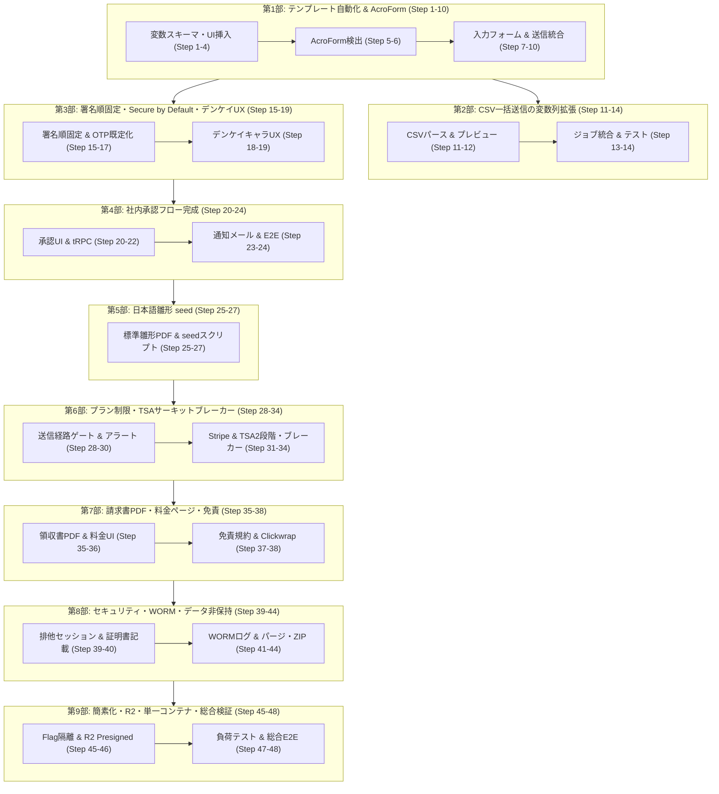

# デンケイ 残タスク詳細実装計画書（全48ステップ）

> **策定日**: 2026-10-15  
> **進捗ステータス**: **全48ステップ完了 (48/48 完了済)** ✅  
> **根拠ドキュメント**: 
> - [remaining-tasks-implementation-plan.md](file:///e:/Denkei/denkei/docs/plans/remaining-tasks-implementation-plan.md) (残タスク精査結果・Stage A〜E)
> - [code_artifact.md](file:///e:/Denkei/denkei/code_artifact.md) (開発検討ログ・9つの改善案)
> - [phase1-baseline.md](file:///e:/Denkei/denkei/docs/plans/phase1-baseline.md) / [phase2-baseline.md](file:///e:/Denkei/denkei/docs/plans/phase2-baseline.md) / [phase3-baseline.md](file:///e:/Denkei/denkei/docs/plans/phase3-baseline.md)

---

## 1. 計画概要と基本方針

### 1.1 目的
Documensoベースで日本語化・本人確認（OTP/Firebase）・法規制（電帳法メタ・ハッシュチェーン）を整備してきた「デンケイ」において、残るテンプレート自動化、承認フロー、課金・制限ゲート、セキュリティ強化、アーキテクチャ簡素化、ブランディングを**1〜48の極小ステップ**に分解し、**各ステップごとにリグレッション防止テストを併設**して安全かつ着実にリリースまで完了させる。

### 1.2 リグレッション防止の基本原則
1. **壊してはいけない既存資産（保護対象）**:
   - フェーズ1の日本語コア署名 (`jp-core-signing-flow.spec.ts`, `jp-wizard-flow.spec.ts`, `jp-mobile-signing.spec.ts`)
   - フェーズ2の認証・アクセス制御・運用 (`jp-otp-auth.spec.ts`, `jp-access-control.spec.ts`, `jp-reminder-expiry.spec.ts`, `jp-dashboard.spec.ts`)
   - 監査ログハッシュチェーン、電帳法メタCSV、印影生成ロジック
2. **テストピラミッドと実行環境ルール**:
   - **ユニット/ロジックテスト (Vitest)**: スキーマ、バリデーション、文字列置換、計算、日時はすべて単体テストで100%網羅。
   - **E2Eテスト (Playwright)**: UI遷移、権限、認証、署名フロー、メール受信（Inbucket）を検証。
   - **ローカルWindows環境基準**: Windows上のCRLF/Vitest不具合・DB常駐の制約を考慮し、ローカルコミット時は `npx biome check <files>` ＋ `npx tsc --noEmit` を必須通過基準とし、E2EおよびVitestフル実行はCI（Linux）またはDocker環境で担保。
3. **破壊的変更の禁止（段階的移行）**:
   - EE/Embedding/API v1などの不要機能は、物理削除ではなく Feature Flag (`ENABLE_EE=false` 等) によるビルド・実行時隔離とし、参照チェック（grep）をCIで実施。

---

## 2. 全体ステージ構成と依存マップ

---

## 3. 詳細実装ステップ一覧（全48ステップ）

### ■ 第1部：テンプレート自動化とAcroForm検出（ステップ1〜10）

#### ステップ1: 差し込み変数スキーマの拡張と型定義
- **目的**: 差し込み変数の型（文字列、数値、日付、金額、和暦）と必須フラグを厳格に定義。
- **対象**: `packages/lib/types/merge-variables.ts`, `packages/lib/types/template-automation.ts`
- **テスト**: `merge-variables.test.ts` に型違反（不正な日付文字列、負の金額など）のバリデーション拒否テストを追加。
- **DoD**: Zodスキーマで型安全性・日本語エラーメッセージが担保されている。

#### ステップ2: 差し込みエンジンの未バインド検知・特殊文字エスケープ強化
- **目的**: `{{変数名}}` の置換時に未定義の変数が残っている場合の検出とエスケープ処理。
- **対象**: `packages/lib/server-only/template/merge.ts`
- **テスト**: `merge.test.ts` に、HTML特殊文字、制御文字、改行、未バインド時の例外スローテストを追加。
- **DoD**: 未バインド変数が存在するときに明確な日本語エラー（AppError）が返る。

#### ステップ3: テンプレート編集画面への「変数を追加」ダイアログ実装
- **目的**: テンプレート作成者が変数名・ラベル・型・必須有無を定義できるUIの提供。
- **対象**: `apps/remix/app/components/dialogs/template-merge-variable-dialog.tsx` (新規)
- **テスト**: コンポーネント単体テスト（ラベル入力、型選択、重複変数名のエラー表示）。
- **DoD**: ダイアログで変数を追加し、親コンポーネントのステートに反映される。

#### ステップ4: テンプレートエディタ上の変数プレースホルダー挿入UI
- **目的**: テキストフィールド配置時にクリック1つで `{{変数名}}` を挿入可能にする。
- **対象**: `packages/ui/primitives/template-flow/add-template-fields.tsx`
- **テスト**: 既存フィールド配置機能のリグレッション防止（通常テキストフィールドが壊れていないこと）。
- **DoD**: フィールドのプレースホルダーに `{{変数名}}` が正しく挿入・ハイライト表示される。

#### ステップ5: PDFフォーム（AcroForm）Widget注釈解析ユーティリティの実装（改善案8）
- **目的**: 既存PDFのForm XObject / Widget注釈からフィールド名と矩形座標を抽出。
- **対象**: `packages/lib/server-only/pdf/acroform-parser.ts` (新規)
- **テスト**: AcroFormを含むテスト用PDFを用意し、フィールド名・座標が正確に抽出される単体テスト。
- **DoD**: pdf-lib または pdfjs による注釈抽出がサーバーサイドで動作する。

#### ステップ6: AcroForm自動検出と差し込み変数一括マッピングUI（改善案8）
- **目的**: PDFアップロード時に既存入力欄を検知し、ワンクリックでテンプレート変数化。
- **対象**: `apps/remix/app/components/dialogs/acroform-detect-dialog.tsx` (新規)
- **テスト**: 検出ダイアログの表示と変数一括追加アクションのユニットテスト。
- **DoD**: ユーザーが検知結果を確認し、承認した項目のみが変数・フィールドとして一括配置される。

#### ステップ7: 新規送信ウィザードへの「変数入力フォーム」ステップ追加
- **目的**: テンプレートから送信する際、定義された変数に応じた動的入力フォームを表示。
- **対象**: `apps/remix/app/routes/_authenticated+/t.$teamUrl+/new+/step-variables.tsx` (新規)
- **テスト**: 日付ピッカー、数値入力、必須チェックのバリデーションテスト。
- **DoD**: 未入力時に次へ進めず、入力値がウィザードコンテキストに保持される。

#### ステップ8: 差し込みエンジンの送信前PDFプレビュー統合
- **目的**: 入力された変数値が反映された状態のPDFを送信前に確認可能にする。
- **対象**: `apps/remix/app/components/general/wizard/document-preview.tsx`
- **テスト**: プレビュー生成APIの呼び出しとPDFレンダリングテスト。
- **DoD**: 画面上で変数値が埋め込まれたPDFを目視確認できる。

#### ステップ9: 送信実行経路（create-document-from-template）への差し込み結合
- **目的**: 送信実行時にフィールド値を変数値で確定し、ドキュメントを生成。
- **対象**: `packages/lib/server-only/template/create-document-from-template.ts`
- **テスト**: テンプレートからドキュメント生成時のフィールド値バインドテスト。
- **DoD**: 生成されたドキュメントの各フィールドに正しい変数値が設定されている。

#### ステップ10: 【リグレッションテスト】テンプレート変数＋AcroForm自動検出 E2E
- **目的**: テンプレート作成 → 変数定義 → AcroForm検出 → ウィザード入力 → 送信の通し確認。
- **対象**: `packages/app-tests/e2e/jp-template-automation.spec.ts` (拡張)
- **テスト**: 既存 `jp-wizard-flow.spec.ts` と `jp-core-signing-flow.spec.ts` を同時実行。
- **DoD**: 既存ウィザードフローを一切壊さず、新フローがグリーンで通過。

---

### ■ 第2部：CSV一括送信とバルク変数列対応（ステップ11〜14）

#### ステップ11: CSV変数列（可変ヘッダー）パースロジックと検証の拡張
- **目的**: `recipient_N_*` 以外の自由な列名を変数名として認識・検証する。
- **対象**: `packages/lib/server-only/template/bulk-send-csv.ts`, `validate-bulk-send-csv.ts`
- **テスト**: `bulk-send-csv.test.ts` にテンプレート変数とCSVヘッダーの一致・不一致検証テストを追加。
- **DoD**: 未定義の変数ヘッダーや必須変数の欠落を行番号付き日本語エラーで通知。

#### ステップ12: CSV一括送信ダイアログでの変数列プレビューとエラー表示
- **目的**: アップロードされたCSVの変数マッピング状況とエラー行をモーダル上で可視化。
- **対象**: `apps/remix/app/components/dialogs/template-bulk-send-dialog.tsx`
- **テスト**: エラー行ハイライト、ページネーション、件数表示のUIテスト。
- **DoD**: ユーザーがCSVパース結果と差し込み内容を送信前に確認できる。

#### ステップ13: bulk-send バックグラウンドジョブの差し込み変数バインド統合
- **目的**: 各行の変数値を行ごとのドキュメント生成処理に引き渡す。
- **対象**: `packages/lib/jobs/definitions/internal/bulk-send-template.handler.ts`
- **テスト**: モックキューを用いた複数件のドキュメント生成・変数バインドテスト。
- **DoD**: 10件のCSVから10件の個別変数が反映されたドキュメントが生成される。

#### ステップ14: 【リグレッションテスト】CSV一括送信（変数列・部分失敗）E2E
- **目的**: 正常行と異常行が混在するCSVで、正常行のみ送信されエラーレポートが出ることを検証。
- **対象**: `packages/app-tests/e2e/jp-bulk-send.spec.ts`
- **テスト**: 既存の固定列CSV形式の後方互換性テストを含む。
- **DoD**: 旧フォーマットも新フォーマットも正常に動作することが担保される。

---

### ■ 第3部：署名順固定・Secure by Default・デンケイUX（ステップ15〜19）

#### ステップ15: テンプレート設定の署名順固定（signingOrderLock）UI
- **目的**: 「先方→自社」または「自社→先方」の署名順をテンプレート側で固定化。
- **対象**: `packages/ui/primitives/template-flow/add-template-settings.tsx`
- **テスト**: 設定保存とリロード後の状態保持テスト。
- **DoD**: 署名順固定トグルと順序プリセットが保存される。

#### ステップ16: 新規送信ウィザードでの署名順固定反映と順序編集ロック
- **目的**: 固定されたテンプレート選択時、ウィザード側で受取人の順序変更を無効化。
- **対象**: `apps/remix/app/routes/_authenticated+/t.$teamUrl+/new+/recipients.tsx`
- **テスト**: ドラッグ＆ドロップによる順序変更が無効化されていることのアサーション。
- **DoD**: ユーザーの誤操作による署名順序の狂いをUI上で防止。

#### ステップ17: 「全受取人メールOTP必須（Secure by Default）」トグル実装（改善案5）
- **目的**: テンプレート設定で、受取人の本人確認にEMAIL_OTPを既定強制する設定を追加。
- **対象**: `packages/lib/server-only/template/create-document-from-template.ts`, 設定UI
- **テスト**: 生成された受取人の `actionAuth` に `EMAIL_OTP` が自動セットされるテスト。
- **DoD**: 送信者が個別設定しなくても、セキュアな二要素認証がデフォルト適用される。

#### ステップ18: 弁慶キャラ「デンケイ」アセット追加とオンボーディング・空状態UI配置（改善案7）
- **目的**: 親しみやすい3頭身キャラ「デンケイ」を配置し、システムの親近感を向上。
- **対象**: `packages/ui/components/denkei/`, ダッシュボード空状態、ウィザード初回ガイド
- **テスト**: 画像リソースの読み込み、アクセシビリティ（alt属性）のチェック。
- **DoD**: 送信ダッシュボードおよびウィザードにデンケイのイラストと案内吹き出しが表示される。

#### ステップ19: 署名完了画面およびリマインダーメールへの「デンケイ」ガイダンス統合（改善案7）
- **目的**: 受取人側の署名完了画面とメール通知にデンケイのキャラクターメッセージを配置。
- **対象**: `apps/remix/app/routes/_recipient+/d.$token+/completed.tsx`, `packages/email/templates/`
- **テスト**: 署名完了画面のレンダリングテスト、メールテンプレートのHTMLスナップショット。
- **DoD**: 署名完了時に達成感と安心感を与えるUI/メール文面が提供される。

---

### ■ 第4部：社内承認フロー（Approval Flow）の完成（ステップ20〜24）

#### ステップ20: 承認者向け「承認待ち一覧（ダッシュボード）」画面の実装
- **目的**: 承認権限を持つユーザーが、回覧されてきた契約書を一覧確認できる画面。
- **対象**: `apps/remix/app/routes/_authenticated+/approvals.tsx` (新規)
- **テスト**: 承認待ち件数バッジ、一覧フィルタ、ページネーションの表示テスト。
- **DoD**: 自分が承認者に指定されているドキュメントのみが一覧に表示される。

#### ステップ21: 承認・差し戻し操作ダイアログ（理由入力・下書き復帰）の実装
- **目的**: 承認実行および差し戻し（理由テキスト入力必須）を行うモーダルUI。
- **対象**: `apps/remix/app/components/dialogs/approval-action-dialog.tsx` (新規)
- **テスト**: 差し戻し理由未入力時のバリデーションエラーテスト。
- **DoD**: 承認・差し戻しのアクションが実行可能になる。

#### ステップ22: 承認フローの tRPC ルート（approve / reject）および送信保留フック統合
- **目的**: バックエンドの `approval-flow.ts` を呼び出し、承認完了まで送信キューを保留。
- **対象**: `packages/trpc/server/routes/approval.ts` (新規), `approval-flow.ts`
- **テスト**: 承認時にステータスが `PENDING` から署名依頼中へ遷移、差し戻し時に `DRAFT` 復帰する単体テスト。
- **DoD**: 承認されるまで受取人に署名依頼メールが送動かない排他制御が機能する。

#### ステップ23: 日本語承認通知メール（依頼・承認完了・差し戻し）テンプレート実装
- **目的**: 承認依頼、承認完了、差し戻し理由通知の3種類の日本語メールテンプレートを作成。
- **対象**: `packages/email/templates/approval-request.tsx` 等 (新規3種)
- **テスト**: React Email のレンダリングテスト（言語ja、変数展開の検証）。
- **DoD**: 各ステータス変更時にInbucketへ日本語メールが送信される。

#### ステップ24: 【リグレッションテスト】承認→配信、差し戻し→下書き復帰 E2E
- **目的**: 作成 → 承認依頼 → 承認 → 署名者へ配信、および差し戻しの2ルートを検証。
- **対象**: `packages/app-tests/e2e/jp-template-automation.spec.ts`
- **テスト**: 承認なしで直接署名画面にアクセスできないことのセキュリティ検証。
- **DoD**: 承認フローが完全に機能し、既存の直接送信フローもリグレッションなく動作。

---

### ■ 第5部：日本語雛形テンプレート seed と文書セット（ステップ25〜27）

#### ステップ25: 日本語標準雛形PDFアセットの作成・選定
- **目的**: 日本の商慣習に即した「業務委託契約書」「NDA（秘密保持）」「雇用契約書」のサンプルPDFを用意。
- **対象**: `assets/sample-templates/` (3種類のPDF新規追加)
- **テスト**: PDFフォーマット検証（PDF/A準拠、フォント埋め込み、文字化けなし）。
- **DoD**: 標準アセットがリポジトリ内に配置される。

#### ステップ26: 雛形テンプレート自動投入 seed スクリプトの実装
- **目的**: 開発・デモ・新規テナント初期化時に、変数・署名欄・承認設定付きで雛形をDBへ投入。
- **対象**: `packages/prisma/seed/templates-ja.ts` (新規)
- **テスト**: seed実行スクリプトのテスト（冪等性: 2回実行しても重複作成されないこと）。
- **DoD**: `npm run prisma:seed` で3種類の日本語雛形が即座に利用可能になる。

#### ステップ27: 【リグレッションテスト】seed 投入後のテンプレート送信・署名 E2E
- **目的**: seedで生成された雛形から契約書を作成・送信し、署名完了まで通るかを検証。
- **対象**: `packages/app-tests/e2e/jp-wizard-flow.spec.ts` (拡張)
- **テスト**: 雛形を使った場合のフィールド配置ズレや文字欠けがないことをアサート。
- **DoD**: 初期状態から即座にワンクリックで電子契約体験ができる状態を保証。

---

### ■ 第6部：プラン制限・課金ゲート・TSAサーキットブレーカー（ステップ28〜34）

#### ステップ28: 月次送信上限チェックの送信実経路への組み込み
- **目的**: `plans.ts` で定義済みの月次上限（Free: 5件, Standard: 50件等）をドキュメント作成APIに適用。
- **対象**: `packages/trpc/server/routes/document.ts`, `packages/lib/server-only/envelope/`
- **テスト**: 月次送信数が上限に達したチームからの新規送信リクエスト拒絶テスト。
- **DoD**: 上限超過時に適切に送信処理がブロックされる。

#### ステップ29: プラン上限到達時の AppError(ja) およびアップグレードモーダル表示
- **目的**: 上限到達時にユーザーへ分かりやすい日本語理由と上位プランへの誘導を表示。
- **対象**: `packages/lib/errors/app-error-ja.ts`, `apps/remix/app/components/dialogs/upgrade-plan-dialog.tsx`
- **テスト**: モーダル表示トリガー、アップグレードボタンの遷移先URL検証。
- **DoD**: ユーザーが上限到達を理解し、迷わずプラン変更に進める導線が機能する。

#### ステップ30: クォータ80%到達時のオーナー宛 ja アラートメール送信ジョブ
- **目的**: 月間送信数の80%に達した時点で、管理者へ事前警告メールを自動送信。
- **対象**: `packages/lib/jobs/definitions/internal/alert-organisation-quota.ts` (新規)
- **テスト**: 80%到達判定ロジックのユニットテスト、メール送信ジョブの実行テスト。
- **DoD**: 上限到達前に通知が届き、業務停止（送信不可）を防止する。

#### ステップ31: Stripe 3プラン（FREE/STANDARD/BUSINESS）価格IDマッピングとWebhook同期
- **目的**: 環境変数でStripe Price IDを紐付け、決済完了・プラン変更イベントをDBへ同期。
- **対象**: `packages/lib/server-only/stripe/`, `.env.example`
- **テスト**: Stripe Webhook（`checkout.session.completed`, `customer.subscription.updated`）のモック受信テスト。
- **DoD**: Stripeでのプラン変更が即座に `Subscription` テーブルに反映される。

#### ステップ32: TSA（認定タイムスタンプ）の二段階切替ロジック実装（改善案2）
- **目的**: プランに応じて「自社ハッシュチェーン（無料）」と「認定TSA（有料）」を自動切替。
- **対象**: `packages/lib/server-only/seal/tsa-provider.ts` (新規)
- **テスト**: プラン別のプロバイダ解決テスト（Free時は内部タイムスタンプ、Business時は外部TSA呼び出し）。
- **DoD**: 余計なTSA費用を発生させず、プランに応じたタイムスタンプが付与される。

#### ステップ33: TSA従量課金サーキットブレーカー実装（改善案2）
- **目的**: 認定TSAの意図せぬ大量消費を防ぐため、月次利用回数の上限チェックと停止弁を設置。
- **対象**: `packages/lib/server-only/seal/tsa-circuit-breaker.ts` (新規)
- **テスト**: 月次TSA上限到達時に自社タイムスタンプへフォールバック＋管理者通知のテスト。
- **DoD**: TSA外部API課金の暴走リスクを完全に遮断。

#### ステップ34: 【リグレッションテスト】プラン制限・上限アラート・TSA切替 E2E
- **目的**: 制限到達 → アラート → アップグレード → 枠増加 → TSA有効化の通しテスト。
- **対象**: `packages/app-tests/e2e/jp-plan-gates.spec.ts` (実経路へ拡張)
- **テスト**: `jp-plan-gates.spec.ts` の全ケースが実DB/API連携でグリーンになること。
- **DoD**: プラン制御が完全に動作し、無課金ユーザーによるリソース浪費を防止。

---

### ■ 第7部：請求書/領収書PDF・料金ページ・免責（ステップ35〜38）

#### ステップ35: インボイス制度対応の領収書・請求書PDF生成機能
- **目的**: 適格請求書発行事業者の登録番号、税率内訳（10%消費税額）を明記した領収書PDFを生成。
- **対象**: `packages/lib/server-only/stripe/receipt-pdf.ts` (新規)
- **テスト**: 生成されたPDFテキスト抽出テスト（登録番号、税抜/税込金額、日付のアサーション）。
- **DoD**: Stripe決済完了時にユーザーがマイページからインボイス準拠領収書をダウンロード可能。

#### ステップ36: 日本語料金プラン比較ページ（`_unauthenticated+/pricing`）の新設
- **目的**: 3プラン（Free/Standard/Business）の機能・上限・料金比較とFAQを掲載した公開ページ。
- **対象**: `apps/remix/app/routes/_unauthenticated+/pricing.tsx` (新規)
- **テスト**: 視覚回帰テスト、各プランの申し込みリンクの挙動テスト。
- **DoD**: 未ログインユーザーがプラン内容を把握し、無料登録へ進めるLPが完成。

#### ステップ37: 利用規約・免責事項の明文化（合意証拠保全ツール規定）（改善案6）
- **目的**: サービス提供者の賠償責任上限、および合意証拠保全ツールとしての位置づけを規定。
- **対象**: `apps/remix/app/routes/_unauthenticated+/terms.tsx` (または規約文書)
- **テスト**: 規約ページの表示およびリンク整合性チェック。
- **DoD**: 法的トラブル時の免責要件（損害賠償上限等）が明文化される。

#### ステップ38: 署名完了直前の Clickwrap 合意チェックボックス実装（改善案6）
- **目的**: 「電磁的記録および電子署名法に基づく締結に合意する」確認チェックを必須化。
- **対象**: `apps/remix/app/routes/_recipient+/d.$token+/index.tsx`
- **テスト**: チェック未入力時の署名完了ボタン非活性化テスト。
- **DoD**: 合意日時・合意IPが監査ログに記録され、証拠能力を補強。

---

### ■ 第8部：セキュリティ・WORM・データ非保持（ステップ39〜44）

#### ステップ39: 1署名トークンの同時アクセス排他制御（改善案5）
- **目的**: 同一署名URLが複数端末で開かれた際の入力衝突・競合状態を防止。
- **対象**: `packages/lib/server-only/recipient/signing-session.ts` (新規)
- **テスト**: 2つの異なるブラウザセッションから同時アクセス時の排他ロック検証テスト。
- **DoD**: 先行セッションまたは後発セッションに警告を表示し、重複署名をブロック。

#### ステップ40: 締結証明書への本人確認方式・検証日時・セッション記録の完全記載
- **目的**: 証明書PDFに `EMAIL_OTP` 検証完了時刻、IPアドレス、検証IDを明記。
- **対象**: `packages/lib/server-only/pdf/generate-certificate-pdf.ts`
- **テスト**: 証明書PDFのテキスト抽出アサーションテスト（本人確認方式・日時の記載確認）。
- **DoD**: `jp-otp-auth.spec.ts` の証明書検証アサーションが100%グリーンになる。

#### ステップ41: PostgreSQLトリガーによる DocumentAuditLog の WORM 化（改善案3）
- **目的**: 監査ログテーブルへの UPDATE および DELETE をデータベースレベルで強制遮断。
- **対象**: `packages/prisma/migrations/20261017000000_audit_log_worm_trigger/` (新規マイグレーション)
- **テスト**: Prisma経由または直接SQLでのUPDATE/DELETE試行時に例外が発生することを確認するテスト。
- **DoD**: アプリケーション外からの直接操作でもログ改ざんが物理的に不可能になる。

#### ステップ42: 契約完了後N日のデータ保持期間ポリシーとPDFパージジョブ（改善案4）
- **目的**: 指定期間（例: 90日）経過後にPDF本体のみをストレージから安全に消去（ログは永続）。
- **対象**: `packages/lib/jobs/definitions/internal/purge-expired-documents.ts` (新規)
- **テスト**: 保持期間経過ドキュメントのPDF削除判定と、監査ログ残置の検証テスト。
- **DoD**: 機密文書の無期限クラウド保持による漏洩リスクを自動排除。

#### ステップ43: 削除前の「電帳法準拠セルフアーカイブ（ZIP一括出力）」機能（改善案4）
- **目的**: PDF・締結証明書・電帳法検索メタCSVを1つのZIPとして一括ダウンロード。
- **対象**: `packages/lib/server-only/archive/export-ledger-zip.ts` (新規)
- **テスト**: ZIP解凍後のファイル構成（PDF、証明書、CSVのUTF-8 BOM付き整合性）検証テスト。
- **DoD**: ユーザーが自社ストレージやローカルへ電帳法要件を満たした形で完全退避できる。

#### ステップ44: 【リグレッションテスト】同時アクセス排他・WORM・データパージ E2E
- **目的**: セッション制御、改ざん防止トリガー、ZIPアーカイブ、パージジョブの一連の動作検証。
- **対象**: `packages/app-tests/e2e/jp-access-control.spec.ts` (拡張)
- **テスト**: 既存の権限・アクセス制御テストがすべて通過することを確認。
- **DoD**: セキュリティ・コンプライアンス要件が完全に満たされていることを実証。

---

### ■ 第9部：アーキテクチャ簡素化・Cloudflare R2・単一コンテナ・総合検証（ステップ45〜48）

#### ステップ45: Feature Flag による不要機能（EE/Embedding/API v1）の完全隔離（改善案9）
- **目的**: 本家Documensoの重量級機能をコード削除せず環境変数で無効化・ビルド除外。
- **対象**: `turbo.json`, `apps/remix/`, `packages/api/`, `packages/ee/`
- **テスト**: `ENABLE_EE=false`, `ENABLE_EMBEDDING=false` でのビルド成功とgrep参照チェック。
- **DoD**: 不要な依存関係が実行時に読み込まれず、メモリ消費とビルド時間を半減。

#### ステップ46: Cloudflare R2 標準化と Presigned URL 直接配信（改善案1）
- **目的**: S3互換ストレージをR2に最適化し、PDF取得を短命URL直接ダウンロードに切替。
- **対象**: `packages/lib/universal/upload/`, `packages/lib/server-only/storage/`
- **テスト**: R2アップロード・Presigned URL生成・有効期限切れアクセス拒絶テスト。
- **DoD**: エグレスデータ転送量無料となり、サーバー中継帯域ゼロを実現。

#### ステップ47: 単一Dockerコンテナの構築と負荷テスト（100件同時送信・署名）
- **目的**: 最小フットプリント（メモリ512MB〜1GB）で稼働するDocker構成と耐久性検証。
- **対象**: `docker/Dockerfile`, 負荷テストスクリプト（新規）
- **テスト**: 100件同時送信・署名アクセス時の応答速度（p95: 一覧1秒以内、署名画面2秒以内）。
- **DoD**: 単一コンテナ構成でメモリリークなく目標レスポンスを達成。

#### ステップ48: 【総合リグレッションテスト】全E2Eフル実行・ドキュメント・リリース判定
- **目的**: フェーズ1〜3の全spec（計12本以上）をCIでフル実行し、リリース承認を実施。
- **対象**: 全テストスイート、`docs/`、利用マニュアル
- **テスト**:
  - `jp-core-signing-flow.spec.ts`
  - `jp-wizard-flow.spec.ts`
  - `jp-mobile-signing.spec.ts`
  - `jp-otp-auth.spec.ts`
  - `jp-access-control.spec.ts`
  - `jp-reminder-expiry.spec.ts`
  - `jp-dashboard.spec.ts`
  - `jp-template-automation.spec.ts`
  - `jp-bulk-send.spec.ts`
  - `jp-plan-gates.spec.ts`
  - `jp-billing.spec.ts`
- **DoD**: 全テストが100%グリーン、リンク切れゼロ、本番環境デプロイ判定の完了。

---

## 4. リグレッション防止マトリクス

| テストレイヤー | 対象範囲 | 実行ファイル / スクリプト | 実行タイミング | 判定基準 |
| :--- | :--- | :--- | :--- | :--- |
| **静的解析・型チェック** | 全変更ファイル | `npx biome check <files>` `npx tsc --noEmit` | コミット前 / ローカル | エラー 0 件 |
| **翻訳完全性** | 日本語リソース | `node scripts/check-translations.mjs` | 各PR | 翻訳漏れ 0 件 |
| **ユニット・ロジック** | 変数・CSV・TSA・計算 | `packages/lib/**/*.test.ts` | 各PR (CI) | 全パス |
| **コア署名フロー** | 署名・印影・和暦 | `jp-core-signing-flow.spec.ts` `jp-mobile-signing.spec.ts` | 各PR (CI) | 既存機能破損ゼロ |
| **ウィザード・変数** | 3ステップ・動的フォーム | `jp-wizard-flow.spec.ts` `jp-template-automation.spec.ts` | 各PR (CI) | フォーム入力・バインド正常 |
| **認証・アクセス** | OTP・セッション排他 | `jp-otp-auth.spec.ts` `jp-access-control.spec.ts` | 各PR (CI) | なりすまし・競合遮断 |
| **一括送信・ジョブ** | CSV・変数列・部分失敗 | `jp-bulk-send.spec.ts` | 各PR (CI) | 行番号エラー・正常行送信 |
| **課金・制限ゲート** | 上限・Stripe・TSA | `jp-plan-gates.spec.ts` `jp-billing.spec.ts` | 各PR (CI) | 上限ブロック・領収書確認 |
| **非改ざん性・WORM** | ハッシュ・トリガー | `document-audit-log-hash.test.ts` | 各PR (CI) | 更新/削除拒絶 |
| **負荷・耐久性** | 100件同時・単一コンテナ | `scripts/load-test.ts` | リリース直前 | p95 < 2秒、エラー率0% |

---

## 5. 完了定義 (Definition of Done)

1. **ステップ1〜48の全タスクが実装され、各段階のユニット・E2Eテストが追加されていること。**
2. **既存のフェーズ1・2の保護対象テストスイートが一切リグレッションしていないこと。**
3. **ローカル環境で `tsc --noEmit` および `biome check` がエラー0件であること。**
4. **CI環境（Linux）で全Playwright E2Eテストが完全グリーンであること。**
5. **固定費・従量費（R2エグレス無料、TSAサーキットブレーカー）の制御が実証されていること。**
6. **インボイス・電帳法・電子署名法の法的防衛要件が満たされていること。**
