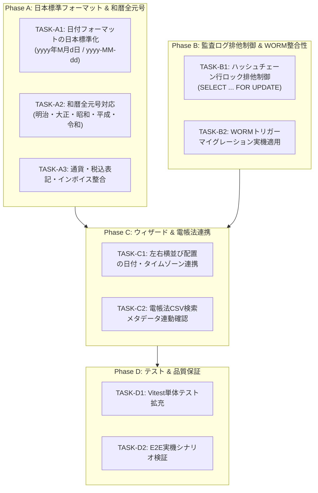

# 日本ローカライズ・電帳法監査排他制御・DB整合性 詳細実装計画書

| 項目 | 内容 |
| --- | --- |
| **対象プロジェクト** | Denkei (Documenso ベース 電帳法・インボイス対応日本版電子契約SaaS) |
| **作成日** | 2026-11-16 |
| **前提コミット** | `45199621` (コードレビュー指摘事項修正・論理削除統一・ウィザード自社自動署名完了) |
| **主要スコープ** | ① 日本商慣習フォーマット完全対応（JST/日付/和暦全元号）<br>② 監査ログハッシュチェーン並行排他制御 (`FOR UPDATE`)<br>③ WORMマイグレーション実機適用 & E2E検証 |

---

## 1. 背景と課題意識

直前のコミット（`45199621`）により、P0の重要セキュリティ課題（XSS、CSVインジェクション、WORMトリガーによるクラッシュ）およびウィザードの署名順・自社自動追加・論理削除（追跡可能性100%維持）の基盤が確立されました。

次のマイルストーンとして、日本の商慣習に根差した契約体験の完成度を高め、高負荷・並行署名下でも電帳法の真実性を絶対に毀損しないシステム基盤を固めるため、以下の課題に対処する実装計画を策定します。



---

## 2. タスク一覧とフェーズ構成

| タスクID | 優先度 | 対象モジュール | 概要 | 状態 |
|---|---|---|---|---|
| **TASK-A1** | **P1** | `date-formats.ts`<br>`time-zones.ts` | 日付フォーマットの日本標準最適化とデフォルト統一 | 未着手 |
| **TASK-A2** | **P1** | `wareki-date.ts`<br>`wareki-date.test.ts` | 和暦変換の全元号（明治・大正・昭和・平成・令和）対応拡張 | 未着手 |
| **TASK-A3** | **P2** | `format-currency.ts` | 金額表記・税抜/税込表記の一貫性保証 | 既存完了・確認 |
| **TASK-B1** | **P0** | `create-document-audit-log.ts` | 監査ログ書き込み時のエンベロープ行ロック（`FOR UPDATE`）排他制御 | 未着手 |
| **TASK-B2** | **P0** | `packages/prisma/migrations` | WORMトリガー更新マイグレーションのDB適用と動作検証 | SQL作成済・未適用 |
| **TASK-C1** | **P1** | `fields.tsx`<br>`recipients.tsx` | ウィザード自動配置フィールドのJST/日本日付連動確認 | 未着手 |
| **TASK-C2** | **P2** | `electronic-ledger-csv.ts` | 電帳法CSVの検索要件（取引日/金額/取引先）出力整合 | 未着手 |
| **TASK-D1** | **P0** | 各 test.ts (Vitest) | 和暦・監査ログ排他制御・日付変換の単体テスト拡充 | 未着手 |
| **TASK-D2** | **P1** | Playwright E2E | ウィザード作成〜左右署名〜完了PDFのE2Eテスト検証 | 未着手 |

---

## 3. 詳細実装仕様

### Phase A: 日本標準フォーマット & 和暦全元号対応

#### TASK-A1: 日付フォーマットの日本標準化
- **対象ファイル**:
  - `packages/lib/constants/date-formats.ts`
  - `packages/lib/constants/date-formats.test.ts`
- **現状の課題**:
  - `DEFAULT_DOCUMENT_DATE_FORMAT` が `'yyyy-MM-dd hh:mm a'`（12時間AM/PM表記）になっており、日本のビジネス契約書（「2026年10月15日」や「2026-10-15」）に合致していない。
  - `DocumentMeta` の `dateFormat` が未指定の場合に、署名欄の完了日付に `AM/PM` が印字されてしまう。
- **実装方針**:
  - `DEFAULT_DOCUMENT_DATE_FORMAT` を `'yyyy年M月d日'` または `'yyyy-MM-dd'` に変更（契約書の日付欄として標準的な `'yyyy年M月d日'` を推奨）。
  - `DATE_FORMATS` 配列の先頭に日本向けフォーマットを配置し、ドロップダウン選択肢の優先度を最適化。
  - 既存テストの期待値を更新。

#### TASK-A2: 和暦全元号対応（明治〜令和）
- **対象ファイル**:
  - `packages/lib/universal/wareki-date.ts`
  - `packages/lib/universal/wareki-date.test.ts`
- **現状の課題**:
  - `WAREKI_ERA_START = '2019-05-01'` でハードコードされており、令和以前の日付に対して `null` を返している。
  - 電帳法対応において、過去の契約書（平成や昭和に締結された契約書）をスキャン保存・メタデータ登録する際に和暦表示できない。
- **実装方針**:
  - `Intl.DateTimeFormat('ja-JP-u-ca-japanese')` は明治以降の元号を完全サポートしているため、下限ガードを明治改元（`1868-09-08` / `1868-01-01`）へ緩和。
  - 各元号（令和、平成、昭和、大正、明治）の1年目を「元年」として正確に出力するロジックを保持。
  - 境界値（1989-01-07: 昭和64年 vs 1989-01-08: 平成元年、2019-04-30: 平成31年 vs 2019-05-01: 令和元年）のテストケースを追加。

```typescript
// 改修イメージ
const MEIJI_START_ISO = '1868-09-08';

export const toWareki = (date: string | Date | DateTime): string | null => {
  // ... 日付パース ...
  const isoDate = dt.toISODate();
  if (!isoDate || isoDate < MEIJI_START_ISO) {
    return null; // 明治以前は非対応
  }
  // formatToParts による元号・年・月・日取得
  // 1年目を「元年」に正規化
};
```

---

### Phase B: 監査ログ並行排他制御 & WORM整合性

#### TASK-B1: 監査ログ書き込み時の行ロック排他制御
- **対象ファイル**:
  - `packages/lib/server-only/document/create-document-audit-log.ts`
- **現状の課題**:
  - `createDocumentAuditLog` では、直前のログを取得（`findFirst`）して `hash` を計算し、新規レコードの `prevHash` に設定している。
  - 同一エンベロープに対して複数の署名者が同時に署名した場合や、リマインダーと署名完了が同時に発生した場合、両者が同じ `previous.hash` を参照してハッシュチェーンが分岐（フォーク）し、電帳法改ざん検知テストでチェーン破損と判定される脆弱性がある。
- **実装方針**:
  - トランザクションクライアント（`tx`）内で実行されている場合、直前ログを取得する前に親エンベロープ行を排他ロックする：
    ```typescript
    await tx.$executeRaw`SELECT 1 FROM "Envelope" WHERE id = ${options.envelopeId} FOR UPDATE`;
    ```
  - トランザクション外の場合は、新たに `$transaction` を張って行ロックと `findFirst` + `create` をアトミックに実行する。

#### TASK-B2: WORM トリガーマイグレーションのローカル適用
- **対象ファイル**:
  - `packages/prisma/migrations/20261116000000_fix_audit_log_worm_fk_set_null/migration.sql`
- **作業内容**:
  - ローカル DB（Docker PostgreSQL）を起動し、Prisma マイグレーションを実行。
  - 監査ログの WORM トリガーが有効であり、外部キーの `SetNull` のみ安全に例外処理されることを SQL / テストで検証。

---

### Phase C & D: 統合検証 & テスト計画

#### TASK-C1 / C2: ウィザード・電帳法CSVの統合確認
- ウィザードで自動生成された署名欄・日付欄が `Asia/Tokyo` / `yyyy年M月d日` で正しく初期化されることを確認。
- 電帳法 CSV ダウンロード機能で、日付（取引日）、金額（円・カンマなし数値）、取引先名が正確に出力されることを確認。

#### TASK-D1 / D2: 単体テスト & E2E検証
- **Vitest 実行**:
  - `npx vitest run packages/lib/universal/wareki-date.test.ts`
  - `npx vitest run packages/lib/constants/date-formats.test.ts`
  - `npx vitest run packages/lib/server-only/document-audit-log-hash.test.ts`
- **TypeScript 型検査**:
  - `cd denkei && npx tsc --noEmit -p apps/remix/tsconfig.json`

---

## 4. 実行手順（Runbook）

1. **ステップ 1 (Phase A: フォーマット・和暦拡張)**:
   - `packages/lib/constants/date-formats.ts` のデフォルト変更とテスト更新
   - `packages/lib/universal/wareki-date.ts` の全元号対応拡張とテスト拡充
2. **ステップ 2 (Phase B: 監査ログ排他制御)**:
   - `packages/lib/server-only/document/create-document-audit-log.ts` への `FOR UPDATE` 排他ロック組み込み
3. **ステップ 3 (Phase C & D: テスト & 型検査)**:
   - Vitest 単体テスト実行
   - Biome リントおよび TypeScript 型チェック
4. **ステップ 4 (コミット & レビュー)**:
   - 変更内容を Git コミットし、差分を確認
