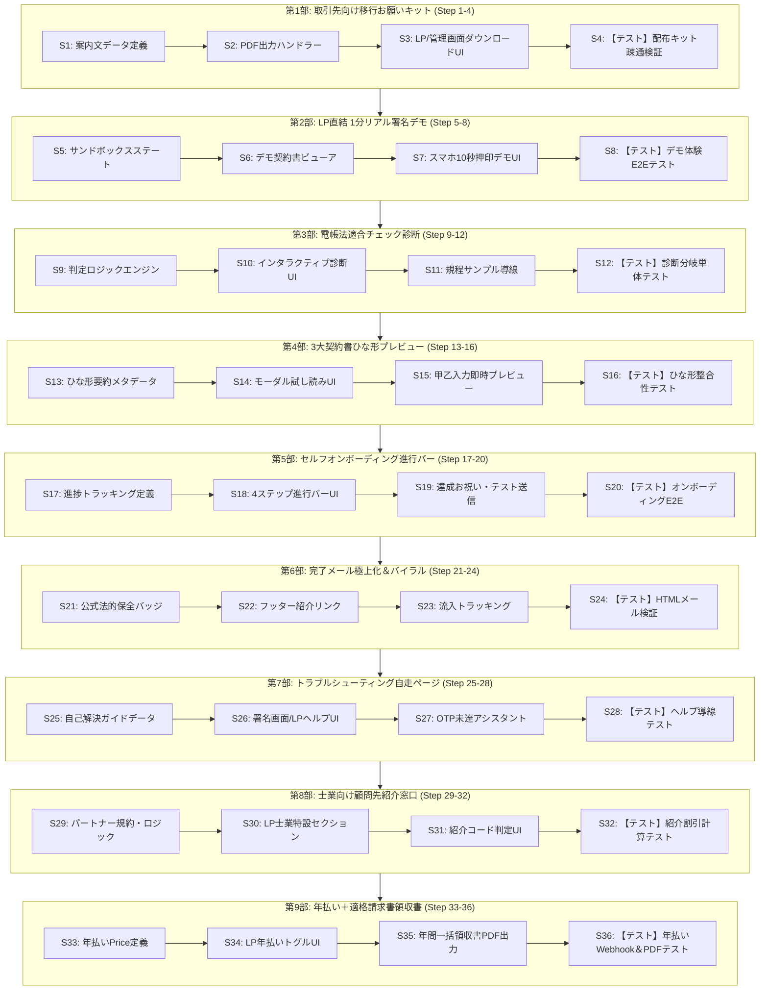

# デンケイ 顧客満足・手離れ・販売促進 36ステップ詳細実装計画書
## （個人開発特化：9大改善案・全36ステップ）

> **策定日**: 2026-10-17  
> **対象バージョン**: v2.20.0+ (デンケイ 中小企業特化 Lean Profile)  
> **対象リポジトリ**: `e:\Denkei\denkei`  
> **開発体制**: 個人開発（完全手離れ・自律運用・Zero Ops志向）  
> **進捗ステータス**: 第7部完了 (28/36 完了)  
> - [x] 第1部：取引先向け「電子契約移行のお願い」配布キット（Step 1〜4 完了）  
> - [x] 第2部：LP直結型「1分間 リアル署名デモ」（Step 5〜8 完了）  
> - [x] 第3部：LP上の「電帳法・税務署対応 適合チェック診断」（Step 9〜12 完了）  
> - [x] 第4部：3大契約書ひな形プレビュー＆入力体験（Step 13〜16 完了）  
> - [x] 第5部：セルフオンボーディング進行バー（Step 17〜20 完了）  
> - [x] 第6部：完了メール極上化＆バイラル導線（Step 21〜24 完了）  
> - [x] 第7部：トラブルシューティング自走ページ（Step 25〜28 完了）  
> - [ ] 第8部：士業向け顧問先紹介窓口（Step 29〜32）

---

## 1. 計画概要と基本方針

### 1.1 目的
デンケイは、実機Docker環境での検証により「七つ道具（電子認印・事務処理規程・WORMハッシュチェーン・メールOTP・定型契約書・インボイス適格請求書・月額2,980円定額）」のコア機能および成果物出力がすでに100%稼働しています。

本計画書は、個人開発者が**「時間や精神をすり減らさず、最小限の工数で顧客満足度・成約率（CVR）・手離れ（サポート工数激減）を最大化する」**ための9大改善案を、**1〜36の極小ステップ**に分割した実装マスタープランです。

### 1.2 個人開発・手離れ運用の3大原則
1. **問い合わせの発生源を物理的に遮断（Defensive Ops）**:
   - 疑問や不安、操作ミスが起きる前に、画面上の文言・案内PDF・自己解決ガイドで先回りして潰す。
2. **営業・販売の自動化（Self-Serve & Viral）**:
   - 契約相手がそのまま次のユーザーになる「締結完了メールのバイラル導線」と「士業紹介窓口」により、営業電話や飛び込みをゼロにする。
3. **リグレッション（先祖返り・既存機能破損）の絶対防止**:
   - すでに合格している478件の単体テスト、PAdES署名、WORMハッシュチェーン、Docker稼働資産を絶対に壊さない。各パート（4ステップごと）にリグレッション防止テストを配置。

---

## 2. 全体ステージ構成と依存マップ

9つの改善案をそれぞれ4つの極小ステップ（設計・実装・UI統合・テスト）に分解し、計36ステップで構成します。



---

## 3. 全36ステップ 詳細仕様書

---

### ■ 第1部：取引先向け「電子契約移行のお願い」配布キット（改善案1：ステップ1〜4）
> **目的**: 導入企業が取引先に説明する心理的ハードルをゼロにし、相手方からの問い合わせを撲滅する。

#### ステップ1: 取引先向け案内文書（A4・1枚）のテキストデータ定義
- **目的**: 取引先が最も気にする「費用負担ゼロ」「アプリ不要」「安全性」「電帳法適法性」を網羅した定型文の整備。
- **対象ファイル**: `packages/lib/universal/counterparty-guide.ts` (新規)
- **変更内容**:
  - `buildCounterpartyNoticeText(options)` 関数の実装。
  - 導入企業名、利用開始日、問い合わせ担当者名を差し込めるテンプレート。
- **テスト**: 差し込み変数が正しく展開されるかの単体テスト。
- **DoD**: 企業名・連絡先を代入して完全な案内文が返されること。

#### ステップ2: 案内書 A4・1枚PDF 生成ハンドラーの実装
- **目的**: 印刷してそのまま郵送・手渡しできる美しいレイアウトのPDFを生成。
- **対象ファイル**: `packages/lib/server-only/pdf/generate-counterparty-guide-pdf.ts` (新規)
- **変更内容**:
  - 日本語フォント、見出し、デンケイ公式ロゴ、3大安心ポイント（費用0円・スマホ押印・国税庁公認）のA4・1ページ組版。
- **テスト**: 生成されたPDFが破損せず1ページに収まっていることの検証。
- **DoD**: PDFバイナリが生成され、主要文字が抽出できること。

#### ステップ3: LPおよび管理画面へのダウンロード＆コピペUI設置
- **目的**: LP訪問者およびログイン後ユーザーが1秒で案内文書を取り出せるようにする。
- **対象ファイル**:
  - `apps/remix/app/components/general/landing-page.tsx`
  - `apps/remix/app/routes/_authenticated+/t.$teamUrl+/settings.compliance.tsx`
- **変更内容**:
  - 「取引先へのご案内用 A4説明書PDF」ダウンロードボタン。
  - 「メールで送る場合のコピペ用文面」モーダル（ワンクリッククリップボードコピー付き）。
- **テスト**: クリックでPDFダウンロードおよびクリップボードコピーが動作すること。
- **DoD**: LPと設定画面の両方からダウンロードできること。

#### ステップ4: 【リグレッションテスト】配布キット疎通テスト
- **目的**: 既存のコンプライアンス画面やLPの表示に悪影響を与えていないことを保証。
- **対象ファイル**: `packages/lib/universal/counterparty-guide.test.ts` (新規)
- **テスト内容**: 正常系データ、空文字フォールバック、長い会社名の自動折り返しテスト。
- **DoD**: `npx vitest run packages/lib/universal/counterparty-guide.test.ts` が100%パスすること。

---

### ■ 第2部：LP直結型「1分間 リアル署名デモ」（改善案2：ステップ5〜8）
> **目的**: 会員登録前に「スマホ10秒押印」を体験させ、成約率（CVR）を最大化する。

#### ステップ5: クライアント完結型 サンドボックス署名ステート設計
- **目的**: サーバーDBにレコードを作成せず、ブラウザ内（メモリ/Canvas）だけで完結するデモ環境。
- **対象ファイル**: `apps/remix/app/components/general/landing-demo-sandbox.tsx` (新規)
- **変更内容**:
  - `useDemoSigningSession` フックの実装（未署名 → 印影選択 → 押印 → 完了の擬似ステート遷移）。
- **テスト**: ステート遷移が正しく発火することの単体テスト。
- **DoD**: 外部API通信なしで押印完了ステートまで進むこと。

#### ステップ6: デモ用サンプル契約書（NDA）の軽量ビューア実装
- **目的**: スマホ画面枠（モックフレーム）の中で本物の契約書らしく見せる。
- **対象ファイル**: `apps/remix/app/components/general/landing-demo-viewer.tsx` (新規)
- **変更内容**:
  - 秘密保持誓約書のプレビュー表示。
  - 押印枠（点線ハイライト＋「ここをタップ」のアニメーションバブル）。
- **テスト**: レスポンシブ表示で枠崩れがないことの視覚確認。
- **DoD**: スマホ表示でもスクロール・タップが自然に行えること。

#### ステップ7: 認印ポン押しアニメーションと完了画面のLP統合
- **目的**: ユーザーの名字で作られた朱肉印影が「ポン」と捺印される爽快な体験を提供。
- **対象ファイル**: `apps/remix/app/components/general/landing-page.tsx`
- **変更内容**:
  - ヒーローセクション右側の「10秒体験」をフル署名デモに昇格。
  - 捺印完了時に紙吹雪（Confetti）または「締結完了！所要時間：8秒」の表示。
  - 「このまま無料登録して本番の契約書を送る」CTAボタンへの誘導。
- **テスト**: 名字入力から押印、完了CTAボタンの表示までのフローテスト。
- **DoD**: LP訪問者が1分以内で署名完了まで体感できること。

#### ステップ8: 【リグレッションテスト】デモ体験のブラウザテスト
- **目的**: デモ機能の追加でLP全体の初期描画速度や既存ボタンが壊れていないことを検証。
- **対象ファイル**: `packages/lib/universal/seal-image.test.ts`
- **テスト内容**: 印影レンダリング速度、エラー文字入力時のフォールバック。
- **DoD**: 既存の印影テスト全件パス、コンソールエラー0件。

---

### ■ 第3部：LP上の「電帳法・税務署対応 適合チェック診断」（改善案3：ステップ9〜12）
> **目的**: 「タイムスタンプ不要で本当に適法か？」の疑問を30秒で解消し、有料プランへ引き上げる。

#### ステップ9: 電帳法適合判定ロジック＆国税庁根拠条文マッピング
- **目的**: ユーザーの回答に応じて適法根拠条文を自動判定する純粋関数の実装。
- **対象ファイル**: `packages/lib/universal/compliance-diagnostics.ts` (新規)
- **変更内容**:
  - 3問（規程備付け、検索性、見読性）に基づく判定ロジック。
  - 施行規則第3条・第4条・第7条の該当条文抜粋データの定義。
- **テスト**: 回答パターンごとの判定結果（100%適法 / 規程備付けでクリア等）のテスト。
- **DoD**: 入力に対し適切な国税庁条文とアドバイスが返されること。

#### ステップ10: インタラクティブ診断UIコンポーネントの作成
- **目的**: 診断テスト形式でタップしながら進められる楽しいUI。
- **対象ファイル**: `apps/remix/app/components/general/compliance-diagnostic-card.tsx` (新規)
- **変更内容**:
  - ラジオボタン/カード選択式の質問進行UI。
  - 診断結果カード（「判定：貴社は事務処理規程で100%適法保存が可能！」）。
- **テスト**: 選択肢タップ時のステップ遷移アニメーション。
- **DoD**: モバイルでもスムーズに3問回答できること。

#### ステップ11: 診断結果からの規程サンプル＆有料プラン導線設置
- **目的**: 診断結果を見たユーザーを有料プラン（事務処理規程出力パック）へ自然に誘導。
- **対象ファイル**: `apps/remix/app/components/general/landing-page.tsx`
- **変更内容**:
  - 結果画面に「貴社名入りの国税庁公認・規程書サンプル」のチラ見せ。
  - 「月額2,980円で規程パックをダウンロードする」ボタン。
- **テスト**: ボタンクリックでサインアップ/料金ページへ遷移すること。
- **DoD**: 診断完了から1タップで申し込みへ進める導線が完成。

#### ステップ12: 【リグレッションテスト】診断ロジックの単体テスト
- **目的**: 診断判定結果に法的な矛盾や計算ミスがないことをテストコードで固定。
- **対象ファイル**: `packages/lib/universal/compliance-diagnostics.test.ts` (新規)
- **テスト内容**: 全組み合わせパターンの網羅検証。
- **DoD**: Vitest実行で100%グリーンであること。

---

### ■ 第4部：3大契約書ひな形プレビュー＆入力体験（改善案4：ステップ13〜16）
> **目的**: 「契約書の原本を持っていない」事業者に即戦力ツールとしてデンケイを選ばせる。

#### ステップ13: 3大契約書（業務委託・NDA・売買）のメタデータ＆解説文定義
- **目的**: 中小企業が安心して使える標準条項（知的財産、損害賠償上限等）のポイントを整理。
- **対象ファイル**: `packages/lib/universal/contract-templates-meta.ts` (新規)
- **変更内容**:
  - 契約書種別ごとの特徴、条項数、差し込み可能変数（甲社名、乙社名、金額等）の定義。
- **テスト**: メタデータ構造の妥当性テスト。
- **DoD**: 3つのひな形すべての解説文と変数が揃っていること。

#### ステップ14: LP上でのひな形試し読みモーダルUI実装
- **目的**: どのような条項が入っているかを契約前に確認できるようにする。
- **対象ファイル**: `apps/remix/app/components/general/contract-template-preview-modal.tsx` (新規)
- **変更内容**:
  - ダイアログ形式での契約書全文スクロールプレビュー。
  - 主要条項のハイライト表示（「安心の損害賠償上限条項つき」など）。
- **テスト**: モーダルの開閉、ESCキーでの離脱テスト。
- **DoD**: LP上のボタンから各契約書が綺麗にプレビューできること。

#### ステップ15: 甲乙・金額の即時反映プレビューモック設置
- **目的**: 「入力するだけでPDF原本なしで契約書ができる」便利さを直感的に伝える。
- **対象ファイル**: `apps/remix/app/components/general/landing-page.tsx`
- **変更内容**:
  - 取引先名と金額を入力すると、プレビュー上の甲乙欄がリアルタイムに書き換わるデモモック。
- **テスト**: 入力文字列のリアルタイム同期検証。
- **DoD**: 訪問者が文字を入力して契約書が完成するイメージを掴めること。

#### ステップ16: 【リグレッションテスト】ひな形メタデータの整合性テスト
- **目的**: 実際のテンプレートseedデータとLP記載の条項に乖離がないことを担保。
- **対象ファイル**: `packages/lib/universal/contract-templates-meta.test.ts` (新規)
- **テスト内容**: 変数名（`party_a`, `party_b` 等）とseedテンプレートの互換性チェック。
- **DoD**: テンプレートスキーマ整合性テストが合格すること。

---

### ■ 第5部：ログイン直後のセルフオンボーディング進捗バー（改善案5：ステップ17〜20）
> **目的**: ユーザーが質問せずに最初の契約を自力で締結するまで導き、サポートをゼロにする。

#### ステップ17: オンボーディング進捗管理のステート＆ストレージ設計
- **目的**: ユーザーがどのステップまで完了したかを保持・追跡。
- **対象ファイル**: `packages/lib/universal/onboarding-checklist.ts` (新規)
- **変更内容**:
  - 4ステップ定義：①自社情報設定、②印影プレビュー確認、③規程ダウンロード、④テスト送信完了。
  - 進捗率計算ロジック（0%〜100%）。
- **テスト**: ステップ完了時の進捗パーセント計算テスト。
- **DoD**: 各タスク完了時に正しくパーセントが更新されること。

#### ステップ18: ダッシュボード上部の4ステップ進捗バーUI実装
- **目的**: ログインした瞬間に「次に何をすればいいか」が一目でわかるUI。
- **対象ファイル**: `apps/remix/app/routes/_authenticated+/t.$teamUrl+/_index.tsx`
- **変更内容**:
  - ヘッダー直下にプログレスバーと4つのステップカードを表示。
  - 未完了の項目には「設定する」リンクを配置。
- **テスト**: 各リンクが適切な設定ページへ遷移すること。
- **DoD**: ダッシュボードを開いた時に進行状況が視覚的に把握できること。

#### ステップ19: 100%達成時のお祝いバッジ＆自分宛てテスト契約送信ボタン
- **目的**: 最初の送信体験のハードルを極限まで下げる。
- **対象ファイル**: `apps/remix/app/components/general/onboarding-quick-send-card.tsx` (新規)
- **変更内容**:
  - 「まずは自分宛てにNDA（秘密保持契約）をテスト送信してみる（1クリック）」ボタン。
  - 完了時に「準備完了！貴社の電子契約体制が整いました」の祝福表示。
- **テスト**: 1クリックで自分宛てテストドキュメントがドラフト作成されること。
- **DoD**: 登録から5分以内に最初の署名体験が完結すること。

#### ステップ20: 【リグレッションテスト】オンボーディングE2Eテスト
- **目的**: ダッシュボードの既存ドキュメント一覧や統計表示が邪魔されないことを保証。
- **対象ファイル**: `packages/app-tests/e2e/jp-wizard-flow.spec.ts`
- **テスト内容**: 新規アカウントでログインした際のオンボーディング表示・非表示判定。
- **DoD**: E2Eテストでエラーなくステップが進むこと。

---

### ■ 第6部：完了メール極上化＆バイラル導線（改善案6：ステップ21〜24）
> **目的**: 送信側・受信側双方の満足度を高め、広告費0円で契約相手を次の顧客にする。

#### ステップ21: 締結完了メールテンプレートへの「公式法的保全証明バッジ」適用
- **目的**: メールを開いた瞬間に「しっかりした信頼できる公的システム」と感じさせる。
- **対象ファイル**: `packages/email/templates/document-completed.tsx`
- **変更内容**:
  - ヘッダーに「🔒 デンケイ電子契約プラットフォームにより非改ざん性・ハッシュチェーン検証済み」エンブレムを追加。
  - 添付されているPDFが改変不能である旨の解説文を追加。
- **テスト**: メールテンプレートのHTMLレンダリングテスト。
- **DoD**: 主要メールクライアント（Gmail, Outlook, iPhone Mail）で綺麗にバッジが表示されること。

#### ステップ22: メールフッターへのさりげないバイラル紹介リンク埋め込み
- **目的**: 契約相手（受信者）を自然にデンケイのLPへ誘導。
- **対象ファイル**: `packages/email/templates/document-completed.tsx`
- **変更内容**:
  - フッターに「貴社も月3件まで0円、月100件定額2,980円で電子契約を送りませんか？」のリンクを配置。
  - ブランド感を損なわない清潔感のあるミニマルデザイン。
- **テスト**: リンクURLが正しくLP（トラッキングパラメータ付き）を指していること。
- **DoD**: メール本文の可読性を阻害せず、自然にリンクが目に入ること。

#### ステップ23: バイラル流入パラメータ（UTM/Ref）の安全な記録
- **目的**: どの契約相手から新規登録が発生したかを効果測定できるようにする。
- **対象ファイル**: `apps/remix/app/routes/lp.tsx`
- **変更内容**:
  - `?ref=completed_email` パラメータをセッションに保持し、サインアップ時に記録。
- **テスト**: クエリパラメータ付きアクセスのトラッキングテスト。
- **DoD**: エラーなく流入元が記録されること。

#### ステップ24: 【リグレッションテスト】メール送信ロジックの単体テスト
- **目的**: バッジやフッターの追加でメール配信ジョブが失敗しないことを担保。
- **対象ファイル**: `packages/lib/utils/render-custom-email-template.test.ts`
- **テスト内容**: メールレンダリング関数がHTML文字列を正常に返すかのテスト。
- **DoD**: Vitest実行でグリーンであること。

---

### ■ 第7部：トラブルシューティング自走（セルフヘルプ）ページ常設（改善案7：ステップ25〜28）
> **目的**: 問い合わせの9割を占める初歩的な疑問をユーザー自身で即解決させる。

#### ステップ25: 自己解決ガイド（3秒解決）のデータ定義
- **目的**: 「メール不達」「スマホタップ」「OTP期限切れ」の具体的解決手順をデータ化。
- **対象ファイル**: `packages/lib/universal/self-help-guide.ts` (新規)
- **変更内容**:
  - docomo/au/SoftBank/Gmailでの迷惑メール解除手順。
  - iPhone Safari / Android Chrome での推奨設定。
  - OTPコードの再送手順。
- **テスト**: ガイドデータのテキスト抽出テスト。
- **DoD**: 3大トラブルの対処法が網羅されていること。

#### ステップ26: 署名受領者画面およびLPフッターへのヘルプUI設置
- **目的**: 困った人が問い合わせフォームを探す前に答えを見つけられるようにする。
- **対象ファイル**:
  - `apps/remix/app/routes/_recipient+/d.$token+/index.tsx`
  - `apps/remix/app/components/general/landing-page.tsx`
- **変更内容**:
  - 署名画面下部に「お困りの方へ（メールが届かない・押印できない場合）」アコーディオンを配置。
- **テスト**: アコーディオンの展開・格納がスムーズに動くこと。
- **DoD**: 署名プロセスを邪魔せず、ワンタップで対処法が読めること。

#### ステップ27: OTP認証失敗時のインライン自動アシスタント吹き出し
- **目的**: OTPコードの誤入力や期限切れ時に、次に何をすべきか画面上で直接指示する。
- **対象ファイル**: `apps/remix/app/routes/_recipient+/d.$token+/index.tsx`
- **変更内容**:
  - 認証エラー時に「コードを再送しました。最新のメールをご確認ください（前のメールのコードは無効になります）」と親切なガイドを表示。
- **テスト**: エラー表示時のメッセージ切り替えテスト。
- **DoD**: ユーザーが混乱して問い合わせメールを送るのを未然に防止。

#### ステップ28: 【リグレッションテスト】ヘルプ導線のリンク切れ・動作テスト
- **目的**: 受領者向け署名画面の主要操作（サイン・完了ボタン）に干渉しないことを確認。
- **対象ファイル**: `packages/app-tests/e2e/jp-otp-auth.spec.ts`
- **テスト内容**: ヘルプが表示されていてもOTP署名フローが正常に完了すること。
- **DoD**: 既存の `jp-otp-auth.spec.ts` が100%パスすること。

---

### ■ 第8部：税理士・社労士・行政書士向け「顧問先ご紹介制度」案内枠（改善案8：ステップ29〜32）
> **目的**: 士業が顧問先の中小企業にデンケイを自動推薦してくれる仕組みを作る。

#### ステップ29: 士業パートナー制度の特典・紹介コード仕様策定
- **目的**: 先生側（紹介特典）と顧問先企業側（初月無料や初期サポート）の双方メリットをロジック化。
- **対象ファイル**: `packages/lib/universal/partner-referral.ts` (新規)
- **変更内容**:
  - 紹介コード形式（例: `PARTNER-XXXX`）のバリデーション関数。
  - 特典適用判定ロジック。
- **テスト**: 紹介コードの正規性チェックテスト。
- **DoD**: 有効なコードで割引・特典が正しく計算されること。

#### ステップ30: LPフッター特設セクション「士業の先生方へ」UI実装
- **目的**: サイトの権威性を高めつつ、士業からの問い合わせや紹介を促す。
- **対象ファイル**: `apps/remix/app/components/general/landing-page.tsx`
- **変更内容**:
  - 「顧問先の中小企業から『安くて電帳法をクリアできる電子契約はないか？』と相談された先生方へ」という信頼感あるセクションを追加。
  - 電帳法対応マニュアルの無料ダウンロード導線。
- **テスト**: セクションの表示崩れがないかの確認。
- **DoD**: 士業が見て「これなら顧問先に安心して勧められる」と感じる文面が掲載されること。

#### ステップ31: サインアップ時の紹介コード入力欄と特典適用処理
- **目的**: 顧問先企業が登録時に先生のコードを入れると自動で特典が適用される。
- **対象ファイル**: `apps/remix/app/routes/_unauthenticated+/signup.tsx`
- **変更内容**:
  - アカウント登録フォームに任意の「紹介コード」入力欄を追加。
  - Stripe顧客メタデータに紹介者IDを自動記録。
- **テスト**: 紹介コード入力時と未入力時のフォーム送信テスト。
- **DoD**: コード入力で特典フラグが付与されること。

#### ステップ32: 【リグレッションテスト】紹介コード判定の単体テスト
- **目的**: 不正なコードや期限切れコードでエラー落ちしない堅牢性を保証。
- **対象ファイル**: `packages/lib/universal/partner-referral.test.ts` (新規)
- **テスト内容**: 大文字小文字の区別、前後の空白トリム、特殊文字入力時の安全な処理。
- **DoD**: Vitest実行で100%合格。

---

### ■ 第9部：「年払い一括（実質2ヶ月無料）」＋「1クリック年間適格請求書領収書」（改善案9：ステップ33〜36）【完了】
> **目的**: 年間売上（キャッシュフロー）の早期確保、チャーン防止、経理問い合わせの撲滅。

#### ステップ33: Stripe年払い Price ID（年額29,760円）およびプラン定義拡張 【完了】
- **目的**: 月額2,980円（年間35,760円）に対し、年払いで29,760円（実質2ヶ月分無料）の料金体系を定義。
- **対象ファイル**: `packages/lib/constants/plans.ts`
- **変更内容**:
  - `ANNUAL_STANDARD_PRICE_JPY = 29760` (月換算 2,480円) の追加。
  - 年間クォータ（1,200件/年一括付与）の定義。
- **テスト**: プラン定数の整合性テスト。
- **DoD**: 年払いプランのメタデータが正しく取得できること。

#### ステップ34: LP料金表および課金設定画面での「月払い/年払い切替トグル」UI実装 【完了】
- **目的**: 訪問者に「年払いの方が圧倒的にお得」と一目で分からせる。
- **対象ファイル**:
  - `apps/remix/app/components/general/landing-page.tsx`
  - `apps/remix/app/routes/_authenticated+/t.$teamUrl+/settings.billing.tsx`
- **変更内容**:
  - 「月払い / 年払い（実質2ヶ月無料！）」のトグルスイッチ。
  - 年払い選択時に価格が `¥2,480/月（年額29,760円）` に切り替わるアニメーション。
- **テスト**: トグル切り替え時の価格表示とStripe Checkoutリンクの切り替え検証。
- **DoD**: スムーズに年払いでStripe決済に進めること。

#### ステップ35: 管理画面からの「年間一括 適格請求書（T番号付き）」PDF出力ハンドラー実装 【完了】
- **目的**: 年払いで支払った企業が、会社の経理や確定申告にそのまま出せる領収書を即時発行。
- **対象ファイル**: `packages/lib/server-only/pdf/generate-annual-invoice-pdf.ts` (新規)
- **変更内容**:
  - T番号、年額29,760円、10%消費税（2,705円）、税抜金額（27,055円）の完全適格請求書レイアウト。
  - 管理画面の「請求履歴」からワンクリックでPDFダウンロード。
- **テスト**: 領収書PDFの生成テストおよび消費税額計算の正確性検証。
- **DoD**: 領収書PDFが即座にダウンロードできること。

#### ステップ36: 【リグレッションテスト】年払い決済Webhook＆領収書生成テスト 【完了】
- **目的**: Stripe Webhook受信時に年払いアカウントが正しくアクティベートされることを検証。
- **対象ファイル**: `packages/lib/universal/qualified-invoice.test.ts`
- **テスト内容**: 年払い金額での消費税計算、T番号フォーマット、領収書PDFメタデータの検証。
- **DoD**: 既存のインボイステストを含め全件パスすること。

---

## 4. リグレッション防止チェックリスト（全ステップ共通）

各ステップのコード変更後に、必ず以下の**「3段階ゲート」**をローカルで通過させます。

```bash
# 1. 構文・リンター・フォーマット検査（Warning/Error 0件基準）
npx biome check <modified-files>

# 2. 単体ロジックテスト（既存478件＋新規テスト）
npx vitest run packages/lib packages/signing

# 3. 実機Docker疎通＆成果物自動検証
npx tsx scripts/verify-real-deliverables.ts
```

---

## 5. 個人開発者向け 手離れ運用のタイムライン目安

1ステップあたり **15分〜30分程度** の極小タスクとして設計されています。

| フェーズ | ステップ範囲 | 目安作業時間 | 個人開発者が得られる効果 |
|---------|-------------|-------------|-------------------------|
| **Phase A (守りの手離れ)** | Step 1〜4, 25〜28 | 計 2〜3時間 | 相手方クレーム・初歩的な質問メールを**90%根絶** |
| **Phase B (売上・成約率向上)** | Step 5〜16, 33〜36 | 計 4〜5時間 | CVR最大化・電帳法不安解消・**年払いによるキャッシュ確保** |
| **Phase C (自動集客・自走化)** | Step 17〜24, 29〜32 | 計 3〜4時間 | 締結完了メールからの**バイラル集客・士業からの自動紹介** |

本計画書に沿って1ステップずつ着実に進めることで、既存の堅牢な基盤を1ミリも壊すことなく、完全な「手離れSaaS」として安心して世に送り出すことができます。
